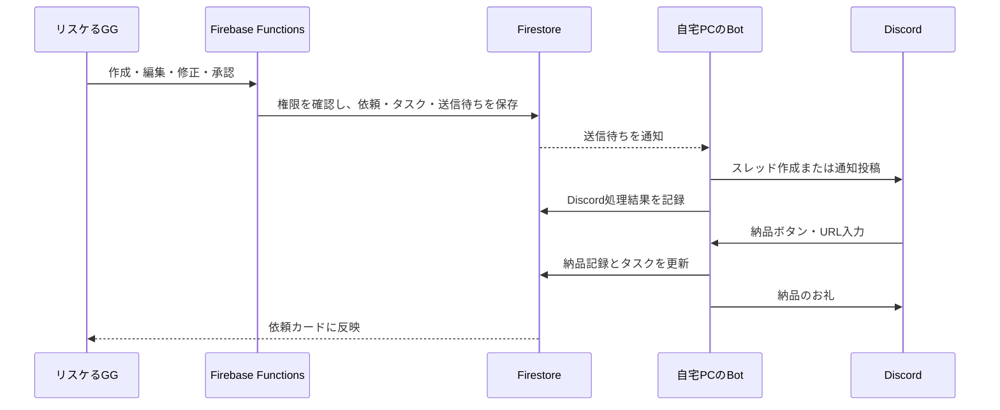

# 動画依頼・サムネイル制作とDiscord連携の仕様

2026年11月21日時点のWebアプリ、Firebase Functions、自宅PC用Discord Botの実装を対象とする。本番への配備・疎通は未確認。

## 利用者と依頼の単位

リスケるGGの「動画依頼」画面（`/video-requests`）で依頼を1件作ると、横動画・ショートともに**動画編集とサムネイル制作の2タスク**ができる。依頼カードは1枚で、納品、修正、承認は制作物ごとに進む。動画が完了してもサムネは確認待ちのまま扱える。

チームのオペレーターとメンバーが依頼の作成・編集・修正・承認を行える。「オーナー用資料URLを追加」はオペレーター専用。編集者はDiscordのスレッドで納品まで操作できる。

## 入力と送信

| 項目 | 動作 |
|---|---|
| タイトル・動画の種類・編集内容 | タイトルをスレッド名に使う。画面で横動画かショートを選ぶ。タイトルと編集内容は空白のみでは保存できない。 |
| 担当編集者 | DiscordユーザーID（17〜20桁の半角数字）を1名以上入力する。複数人はカンマ区切り。重複は1名にまとめる。編集者はリスケるGGへの登録不要。旧方式の依頼は担当欄をそのまま保存すれば従来のメンバー指定を引き継ぐ。 |
| プロマネのリンク・タイトル案（仮） | どちらも必須。プロマネはHTTPまたはHTTPSのURL。仮タイトルをサムネの制作依頼に掲載する。 |
| 共有事項・編集開始日 | 任意。共有事項は編集スレッドに掲載する。 |
| 初稿納期・完パケ納期 | どちらの動画形式でも必須。編集開始日 ≦ 初稿納期 ≦ 完パケ納期。同日は可。順序違反は作成・編集とも保存できない。両タスクの期限とサムネの納期には完パケ納期を使う。 |

## 依頼から承認まで

| 操作 | 依頼カード・タスク | Discord |
|---|---|---|
| Discordへ送信 | 依頼と2タスクを一括作成。両方ともDiscord待ち（タスクは「未着手」） | Botが送信待ちを取得 |
| スレッド作成成功 | 両方が作業中。対応する列があればタスクを「進行中」または「作業中」に移動 | 編集は送信先チャンネルごとに1スレッド、サムネは専用チャンネルに1スレッド |
| 動画またはサムネを納品 | 対象だけ確認待ちになり、タスクが「見てくれぃ」へ移動 | 対象スレッドにお礼を投稿 |
| 修正を依頼 | 対象だけ作業中へ戻る | 対象スレッドに担当者メンション、修正内容、再納品ボタンを投稿 |
| 承認 | 対象だけ完了。完了列は状態名ではなく `role=done` で特定 | 対象スレッドに担当者メンションと承認メッセージを投稿 |

編集の初回投稿には編集内容・プロマネ・共有事項と納品ボタンが載る。初稿・完パケの日付は編集の初回本文には載らない。サムネの初回投稿には仮タイトル・完パケ納期・編集スレッドへのリンクが載る。

### 動画の納品

「納品URLを追加・再納品」でURL（必須、最大1,000文字）と共有事項（任意、最大2,000文字）を送信する。表示はギガファイル便だが、入力判定はHTTP／HTTPSで始まるかどうか。カードには異なるURLが「納品ファイル1」「納品ファイル2」…と並ぶ。オーナー用の共有資料は別枠で、追加しても納品扱いにならない。

初回のお礼は「初稿が納品完了丸！ありがとうございます！」「確認されるまでお待ちください。」。異なるURLが2件以上になると「修正ファイルの納品ありがとうございます！」「さっそく確認します！」に変わる。どちらも納品URLと入力済みの共有事項を添える。同じURLを再送してもファイル番号は増えない。動画のお礼本文には担当者メンションを明示していない。

### サムネの納品

画像をスレッドに直接投稿し、投稿した本人が「サムネを納品」を押す。Botは直近100投稿から、押したボタンの投稿より後に本人が添付した画像を探す。対応スレッド・作業中の依頼に限り受け付け、再納品には前回より新しい画像投稿が必要。カードは最新のDiscord投稿へのリンクを保持する。

お礼の宛先は動画形式に設定されたサムネ担当者。**Aさんが画像を投稿してボタンを押し、担当者がBさんなら、Bさんにメンションする。** 初回は「サムネの納品ありがとう！」、前回の納品記録があれば「修正ありがとう！」。いずれも次の行は「確認するので待っててクレヨン」。確認待ちの間にもう一度押しても二重納品しない。

「サムネを承認して完了」は制作中（修正作業中を含む）と確認待ちで使える。画像の納品前でもサムネタスクを完了にし、専用スレッドへ承認を通知する。サムネの修正依頼は確認待ちのときだけ可能で、本文は1〜1,500文字。動画側は未完了時に修正・承認の操作を表示し、動画納品処理にはサムネと同じ状態チェックがない。完了後も古い動画納品ボタンから送信すると確認待ちに戻り得る。

## 送信後の編集と削除

スレッド作成済みの依頼を編集すると、変更した項目を対象ごとにまとめて既存スレッドへ投稿する。変更がゼロなら通知を作らない。

| 送信先 | 変更項目 |
|---|---|
| 編集とサムネの両方 | タイトル、完パケ納期。タイトル変更時はスレッド名も更新 |
| 編集のみ | 担当編集者、動画の種類、編集内容、プロマネ、共有事項、編集開始日、初稿納期 |
| サムネのみ | タイトル案（仮） |

担当変更時も既存の編集スレッドを使用する。通常のタスク削除で動画タスクを消すと、依頼カードと関連サムネタスクも削除する。サムネタスクだけを消すと、依頼とのサムネの紐付けを外して動画側を残す。Discordスレッドの削除は行わない。

## 連携構成と本番での前提

- 依頼本体は `teams/{teamId}/videoRequests/{id}`。動画は `status`、サムネは `thumbnailStatus`、初回スレッド作成は `discord.status` で別々に管理する。編集・修正・承認の通知は依頼配下の `discordEvents` に保存する。
- 編集の送信先は `EDITOR_CHANNEL_MAP`、未指定の編集者は `SOURCE_CHANNEL_ID`。サムネは `TARGET_CHANNEL_ID`。メンションは横動画が `THUMBNAIL_MENTION_IDS_LONG`（共通設定への代替あり）、ショートが `THUMBNAIL_MENTION_IDS_SHORT`。
- ローカルは `RISUKERU_USE_EMULATOR=true`。本番はエミュレーター指定を解除し、本番のサービスアカウント（`FIREBASE_SERVICE_ACCOUNT_JSON`）と `RISUKERU_TEAM_ID` を設定する。アプリ・Functions・Botの接続先を揃え、Discordのスレッド作成・投稿・画像投稿の読み取りができる状態でBotを稼働させる。
- Bot停止中の新規依頼は送信待ちに残る。初回作成は `queued → creating → created`、追加通知は `queued → sending → sent`。処理開始をトランザクションで確保するが、Discord投稿とDB保存は別処理。途中停止時は一部のスレッドや処理中状態が残り得る。
- 失敗は `failed` とエラー内容を記録する。作成失敗後の編集保存は `pending` に戻す一方、現行Botが取得するのは `queued` のみ。編集保存だけでの自動再送は期待できない。修正・承認はDB更新が先なので、カードの完了表示だけでは通知成功を判断できない。
- 本番では `discordEvents.status` のコレクショングループ検索用インデックスを確認する。リポジトリの `firestore.indexes.json` にこの定義はない。また、通知を取得済みにする処理がチーム判定より先に走るため、同一DBで複数チームのBotを動かすと別チームの通知が `sending` に残り得る。

## 動作確認の観点

| ケース | 確認する結果 |
|---|---|
| 横動画・ショートを各1件作成 | 各2タスク、編集の送信先数に応じたスレッド、サムネ1スレッド。形式別の担当者と納期が正しい |
| 必須欄を空欄にする／日付を逆順・同日にする | 空欄・逆順は保存不可。同日は保存可能 |
| 仮タイトルのみ変更／完パケのみ変更／変更せず保存 | 順にサムネのみ・両方・通知なし。無関係な項目は本文に出ない |
| 動画を納品、修正、別URLで再納品、承認 | 共有事項と番号付きリンク、再納品ボタン、完了列と承認通知を確認。サムネの状態は独立 |
| 担当者以外が自分の画像を投稿してサムネを納品 | お礼は設定担当者宛て。修正後の新画像で文面とリンクが切り替わり、連打で増えない |
| Bot停止中に依頼し、同じ環境で再起動 | 停止中は未着手。復帰後は各スレッドが作られ、カードから開ける |

実装参照先はWeb側の `src/app/(protected)/video-requests/page.tsx`、`functions/src/videoRequests/`、`functions/src/tasks/deleteTask.ts`、Bot側の `C:\dev\bot開発\src\risukeruSync.js` と `src/index.js`。関連するタスク仕様は[タスクの操作フロー](../task/flows.md)を参照。
