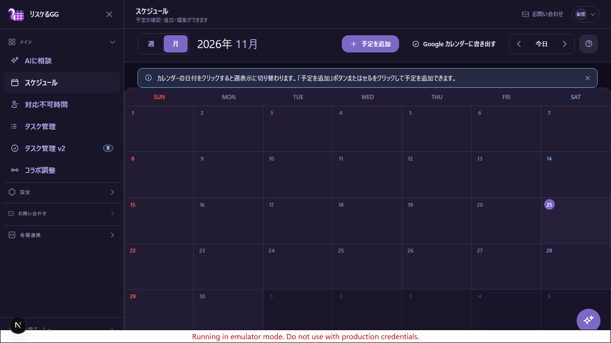
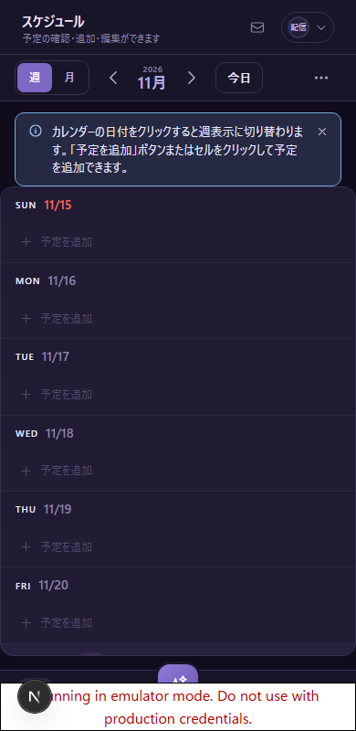
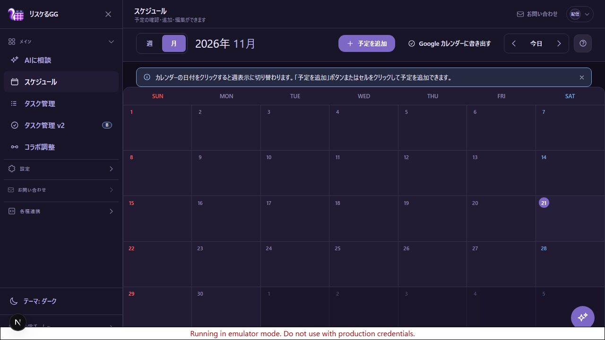
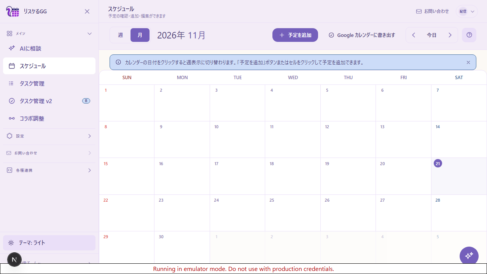
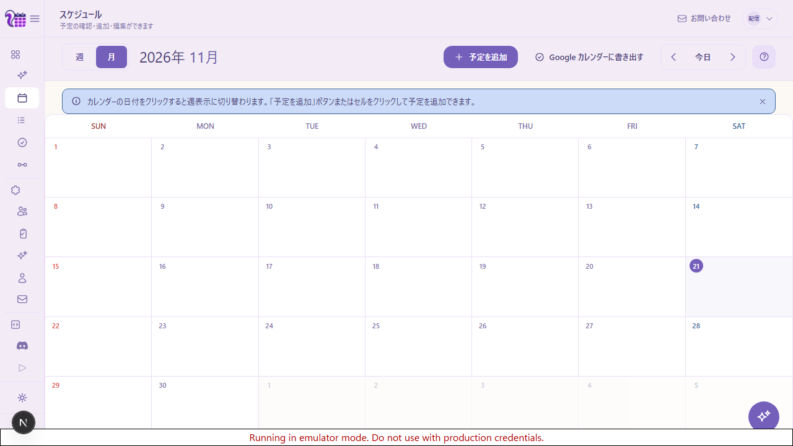
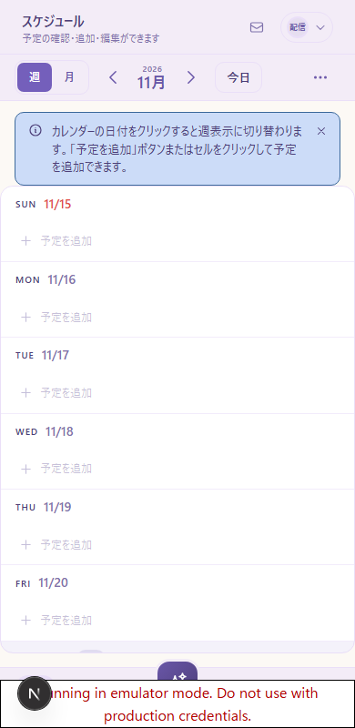
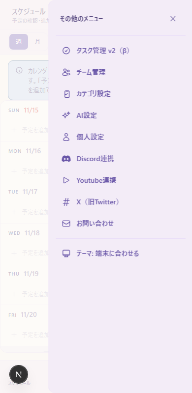
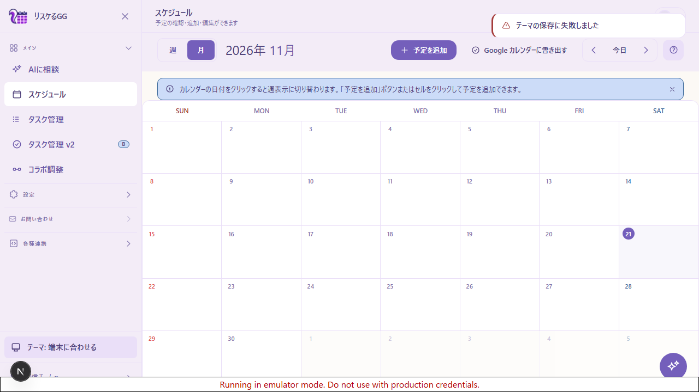

# PR 240 最終レポート（HEAD e6c5cf86）

## 概要
ライト / ダーク / 端末に合わせる の3値テーマ切り替えを追加した（#215）。サイドバー下部（折りたたみ時はアイコンのみ）とモバイル「その他」ドロワー最下部のボタンで巡回切り替え。選択は localStorage と Firestore（users/{uid}）に保存し、別端末・リロード後も復元する。実装は next-themes。themeColor / manifest は変更なし。

## 画面の変更
変更前（develop）

変更後

## lint / E2E 定義の変更
- playwright.config.ts: emulator プロジェクトの testMatch に `**/e2e/theme-toggle.spec.ts` を追加（既存設定の緩和・削除なし。Emulator 必須のため smoke には入れていない）。
- tests/e2e/theme-toggle.spec.ts を新規追加（リロード維持、localStorage 削除後の Firestore 復元、system の OS 設定追従）。
- eslint 設定・抑制コメントの変更なし。

## 確認済み
- pnpm verify: 36 files / 279 tests pass。
- Emulator E2E theme-toggle: 1 passed。
- 実操作: 保存失敗時は表示は切り替わり toast「テーマの保存に失敗しました」、別タブへの反映、折りたたみ・ドロワー表示、コンソールエラー 0 件（develop と同等）。
- 正本仕様（ui/*, user/model）同期済み。

## 人が見るべき点
- 別タブを開いた直後 1 秒未満に他タブで操作すると、まれに表示が一時的に不一致になる（4 回中 1 回）。仕様未定義の範囲として指摘せず。
- 依存 next-themes を追加。
- 未実施: 実 OS のカラースキーム切替、実機 iOS/Android、本番 Firebase。

## レビュー経緯
最終セット（scope=full）一次・二次とも pass、要修正 0 件。起票した Issue なし。
