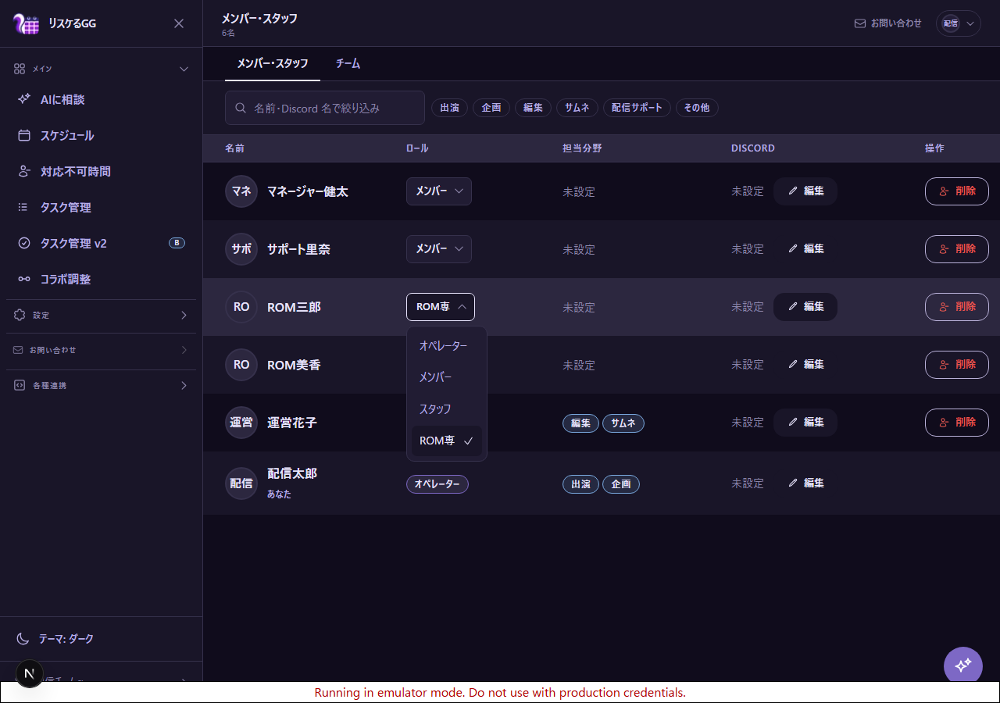

# 最終レポート PR #247（ロール 2 種化 PR A: staff を編集者として認識）

SHA: f94aeaf

## 何が変わったか
- 新ロール値 `staff` を、旧 `member` と同じ「編集者」として認識するようにした（互換対応のみ）。
- 対象: Firestore ルール（isOwnerOrEditor）、Functions（validateAuth / joinTeam / updateMemberRole）、クライアント 5 画面と useBriefOps、型・ロール変更ダイアログ。判定は `canEditRole`（src/lib/utils/teamRoles.ts）に集約。
- 既存ロール（operator / member / rom）の権限の挙動は変えていない。rom は追加していない。
- 仕様の「選択肢を 2 つにする」「旧値の変換」は PR B 以降。

## 確認結果
- `pnpm verify`（lint + typecheck + functions build + unit test）: OK。
- CI: 通過。
- ユニット: tests/unit/teams 39 件 pass（`canEditRole`: operator/member/staff=true、rom/null/undefined=false）。
- Emulator ルールチェック `scripts/check-role-rules.mjs`: `role rules: OK`。operator/member/staff=200、rom・部外者=403。staff をルールから外すと失敗することも確認済み（空振りしない）。
- 編集者判定の grep で取りこぼし無し。抑制コメント・TODO の追加なし。

## 画面の変更
- 画面の見た目は変わらない（編集可否の条件式と、ロール変更ドロップダウンの選択肢追加のみ）。
- 実画面で確認した（Emulator 上の /team、operator でログイン、ROM専 のロール変更ドロップダウンを開いた状態）。選択肢に新しい「スタッフ」が出ること、他の表示（名前・担当分野・Discord・操作列）は変わらないことを見た。
- 確認は選択肢の表示まで。staff へ実際にロール変更を保存する操作は行っていない（保存側はルールチェックとユニットで担保）。

## デプロイ順
1. Firestore ルール・Functions
2. クライアント
3. 本番作業①（既存データの確認）。**0 件確認が取れるまで PR B はマージ不可**。

## 未解決事項
- #248: two-roles.md の PR 分割表（193 行目）で変換関数が PR A に入っている。PR B へ移す（仕様側の修正）。変換関数は PR B で実装する（PR A では意味が変わらず恒等写像にしかならないため）。
- 補足: `file-issue.mjs` は Windows で検索クエリが分割され失敗した。#248 は `gh issue create` で直接起票。スクリプト不具合は記録モードで task 化予定。

## レビュー経緯
一次・二次を 2 セット実施。最初の二次 fail は、ルールテスト不在・変換関数の扱い・PR 本文の確認欄の不足。いずれも解消し、現 HEAD で scope=full の一次・二次とも pass。
