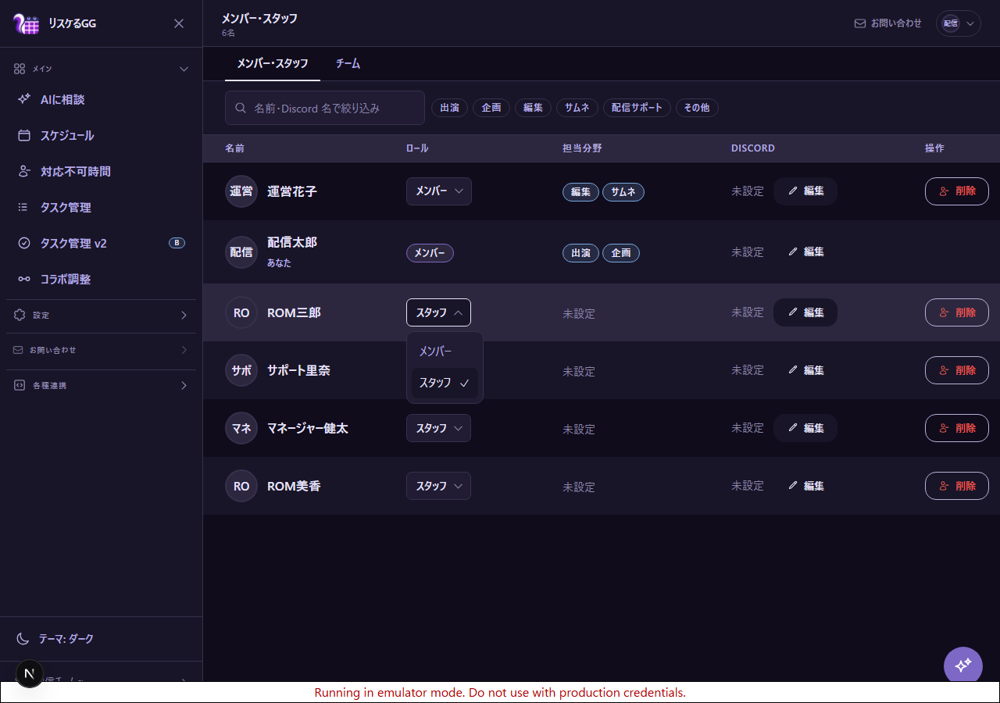
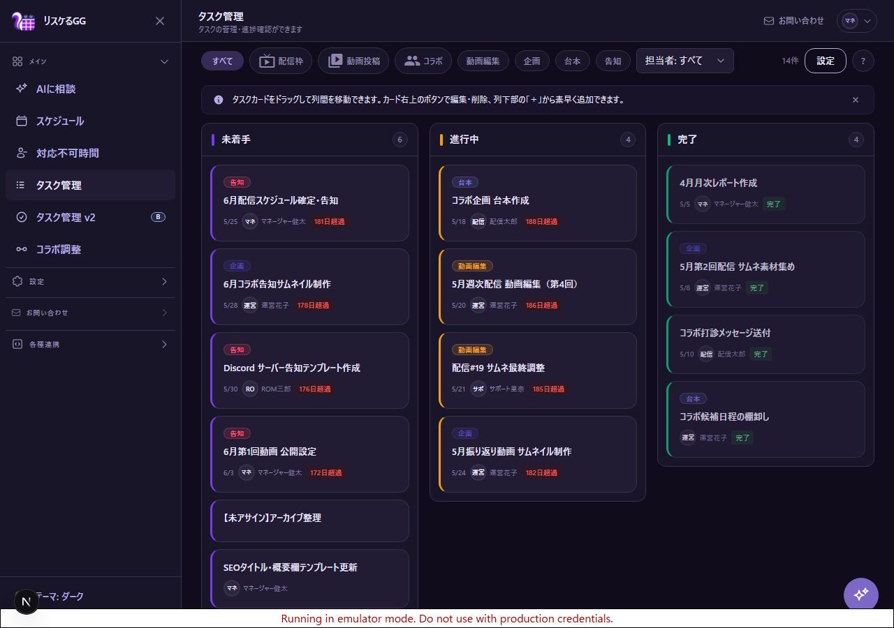
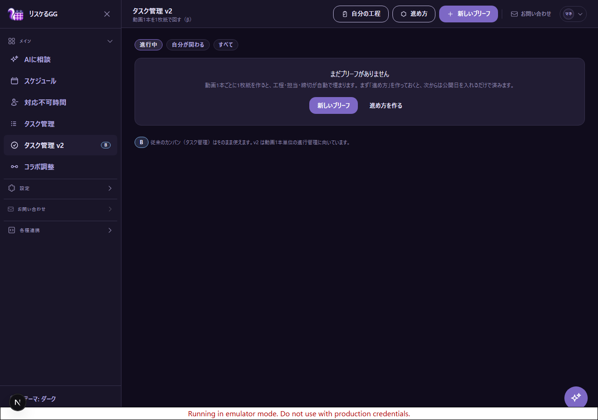
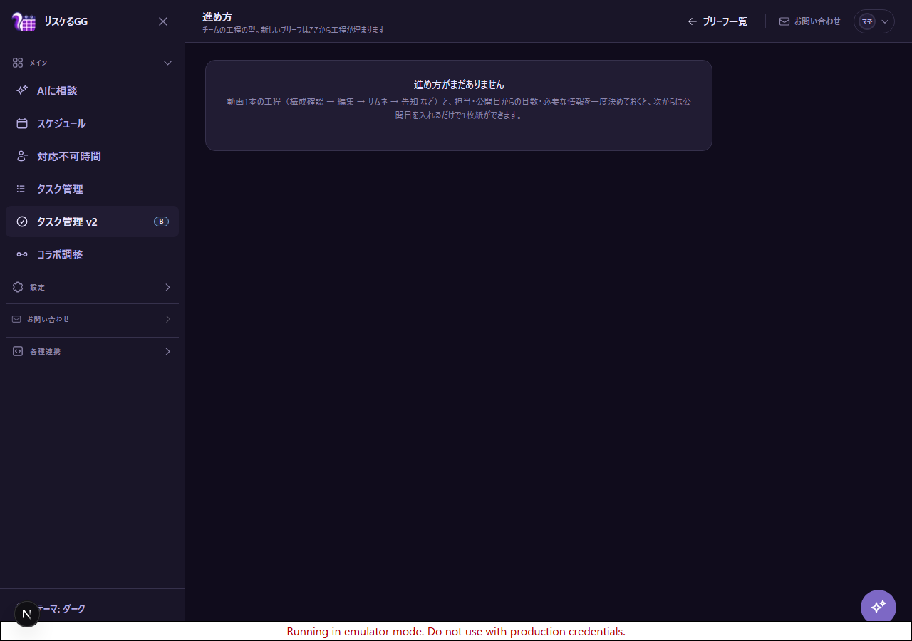
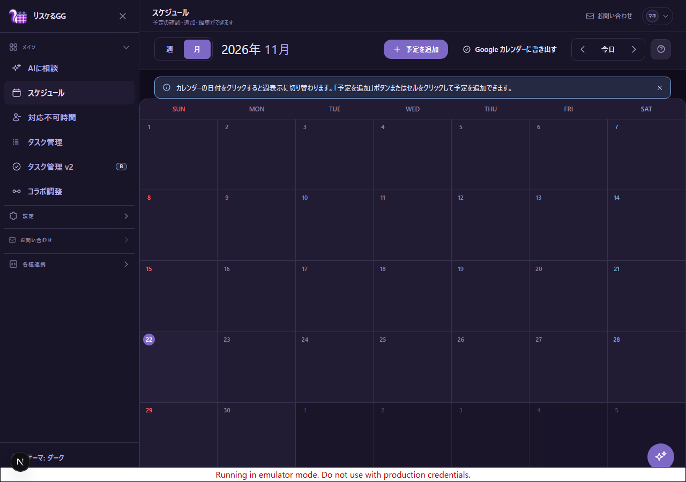
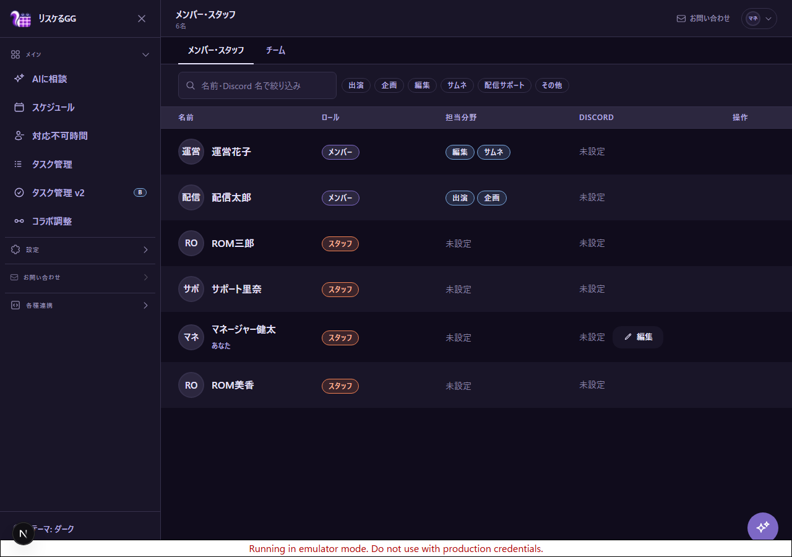

# 最終レポート PR #258（#219 PR B-2: クライアントを メンバー / スタッフ の 2 ロールに切り替え）

対象 HEAD: 326abba。一次・二次レビューとも scope=full で pass。

## 変更内容

- **ロール定義と権限判定の集約**: `TeamRole`（member / staff）、`toTeamRole`、権限判定を `src/lib/utils/teamRoles.ts` に集約。旧ロール値は読み込み時に変換する。
- **スケジュール・ブリーフ・工程の権限**: ロールに応じて編集・作成・状態遷移の可否を判定。担当者本人の完了操作は維持。
- **操作層 3 関数**: ブリーフ操作の port / index、`useBriefOps` を新ロールに合わせて更新。
- **ロール変更 UI**: メンバー一覧のロール列をドロップダウン化し、RoleChangeDialog で確認。
- **AI 提案**: 提案の登録可否をロールで出し分け（`proposalPermission`、systemPrompt、registry）。
- **Discord Route**: `/api/discord/*` 8 本の権限チェックを新ロール判定へ。
- **文言・シード**: 旧ロール名（オペレーター等）をメンバー / スタッフへ。`scripts/seed.mjs` も更新。
- テスト追加・更新: teamRoles / canEditRole / roleChangeVisibility / leaveTeamLogic / operations / proposalPermission / systemPrompt。

## 画面の変更

メンバー（配信太郎）でのロール変更ドロップダウン。他メンバーの行だけ変更でき、自分の行はバッジ表示。

スタッフ（マネージャー健太）での表示。

タスク管理（/tasks）

ブリーフ一覧（/briefs）

進め方（/briefs/playbooks）

スケジュール（/schedule）

メンバー・スタッフ（/team）。ロールの表示はバッジのみで、編集操作は自分の Discord 名のみ。

他ページのメンバー / スタッフ別の画像は `rv-*.png` としてレポート一式に含む。

## 確認結果

- `pnpm verify`（lint / typecheck / functions build / unit）通過。unit 412 件。
- CI 通過。
- Emulator で実画面を確認。メンバー・スタッフ両方で /tasks /briefs /briefs/playbooks /schedule /team /collabs /settings /integrations/discord を表示。
- 担当者の完了ボタンと AI 提案カードの出し分けは unit のみで確認（実画面では未確認）。
- Firestore への書き込み拒否は B-1（#257）のルールのチェックで担保し、本 PR では実機確認していない。

## デプロイ時の注意

- **B-1（#257）・B-2（本 PR）・B-3 は同時にデプロイする**。片方だけだと旧ロール値と新判定が食い違う。
- 本番作業①（ロールを staff へ寄せる移行スクリプト）は実施済み。
- B-1 と本 PR で、ロール判定の引数が一致していることを確認済み。

## 既知の点（本 PR では対応しない）

- 退出ダイアログの文言と実際の挙動の食い違いは従来からあるもの。本 PR で悪化はしていない。
- /tasks の案内文（「タスクカードをドラッグして…」）はスタッフにも同じ文面が出る。操作可否との整合は今回の範囲外。

## lint / E2E 定義の変更

`tests/e2e/visual.spec.ts` はコメント中の「オペレーター」を「メンバー」に直しただけで、テストの挙動は変わらない。lint 設定・CI 定義の変更はなし。
