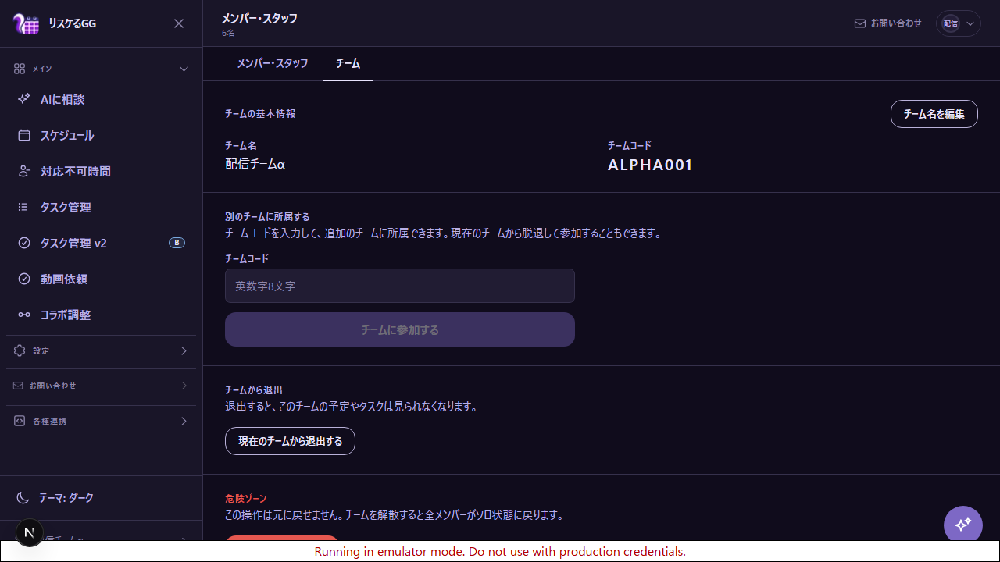
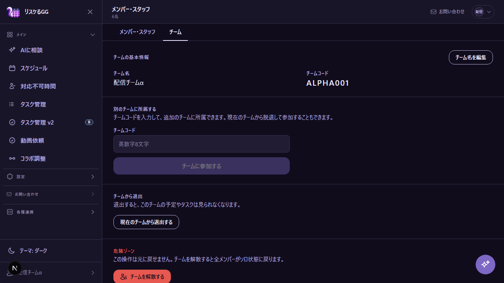
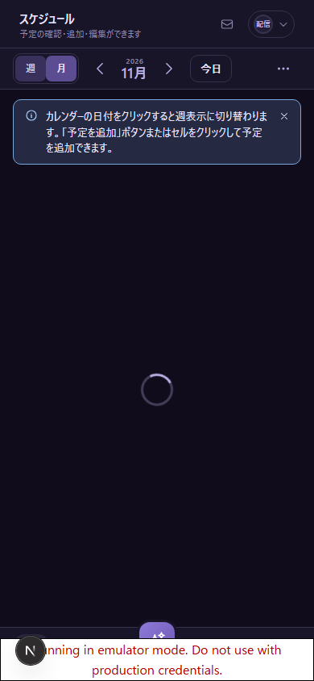
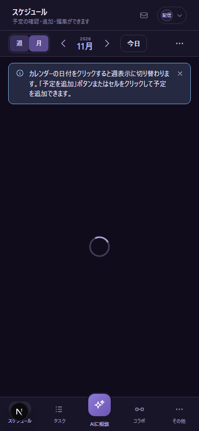

# 最終レポート

## 二次レビュー結果まとめ

- 最終セットの結論: 合格。Emulator 接続時に画面下端へ出る警告バナーを出さないようにする 1 行の変更（`src/lib/firebase/client.ts`）で、本番の経路は変わらない
  - 一次の確認範囲: #242 の対象 2 件を含む `tests/e2e/visual.spec.ts` の実行（8 件成功、対象 2 件の 5 回繰り返しで 10 件成功）、変更前後でバナーの有無とクリックの可否（デスクトップ・モバイル幅）、`connectAuthEmulator` の呼び出し元（1 箇所だけ）、CI（すべて成功）
  - 二次が妥当とした根拠: 一次の記載はコード・履歴と一致した。二次でも変更後のコードを動かし、バナーが 0 件で、チームスイッチャーと「その他」ボタンをクリックできることを確認した
  - 対象 2 件のテストは、現在の develop ではこの修正が無くても通る（#232 でチーム切替の操作がクリックからキー操作に変わったため）。そのため「修正前に落ち、修正後に通る」はテストでは示せず、バナーがクリックを奪うことを変更前後で直接確かめて、受入条件の達成とした
- 二次が不適切と判定した一次の指摘: なし。判定に影響しない訂正が 2 点あった
  - develop との差は 3 コミットではなく 6 コミット（どれもこの PR が変えるファイル・E2E を変えていない）
  - 一次の変更後スクリーンショット（デスクトップ）が読み込み途中のものだったので、撮り直したものに差し替えた
- 別 Issue に切り出した指摘: #296 E2E（emulator）の visual.spec.ts のチーム切替テストが、警告バナーと無関係にときどき失敗する

| セット | 範囲 | 一次判定 | 二次判定 | 主な指摘・判断 |
| ------ | ---- | -------- | -------- | -------------- |
| 1（最終） | full | pass（要修正 0 件） | pass | 推奨: バナーが戻ったら落ちるテストが無い（必須にしていない）。要確認: ブランチが develop より遅れている（競合なし）。範囲外の不安定なテストは #296 に起票 |

## 画面の変更

開発用の Emulator に接続しているときだけの変更。本番の画面は変わらない。

| 画面・操作 | 変更前 | 変更後 |
| ---------- | ------ | ------ |
| チーム管理（`/team?tab=team`、1280x720）。左下のチームスイッチャーをクリックする |  赤字のバナーがチームスイッチャーに重なり、クリックできない |  バナーは出ず、クリックできる |
| スケジュール（`/schedule`、390x844）。下部ナビの「その他」をクリックする |  バナーが下部ナビに重なり、クリックできない |  バナーは出ず、クリックできる |

## 人が確認すべき点

- バナーが再び出るようになっても、落ちる自動テストは無い。足せるのはローカル専用の emulator プロジェクトのテストだけで、CI では検出できない。足すかどうかの判断（一次の推奨 P1）
- Emulator 接続中であることを示す画面上の表示が無くなる。開発中に本番と取り違えないための目印が要るかどうかの判断
- ブランチは develop より 6 コミット遅れている。競合は無いが、マージした結果での E2E は実行していない
- PR は Draft で作られた。Draft の理由だった E2E の未確認は一次レビューで解消し、本文の更新と Draft の解除はレビュー後に行った
