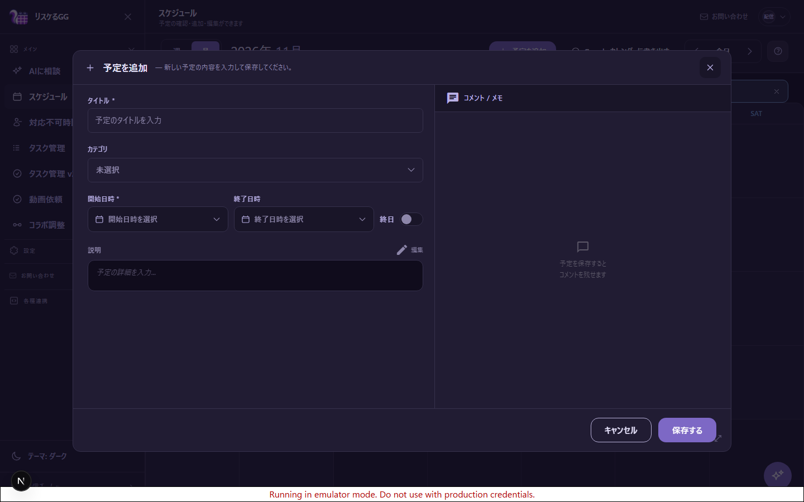
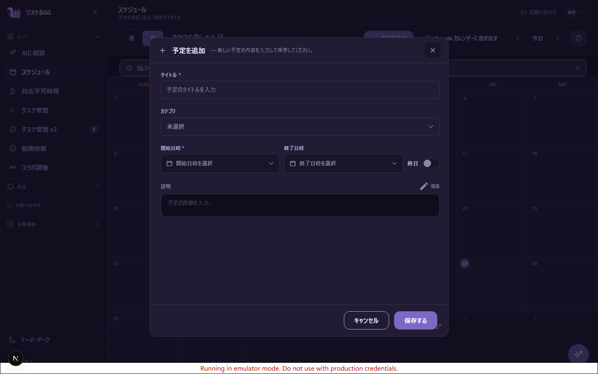
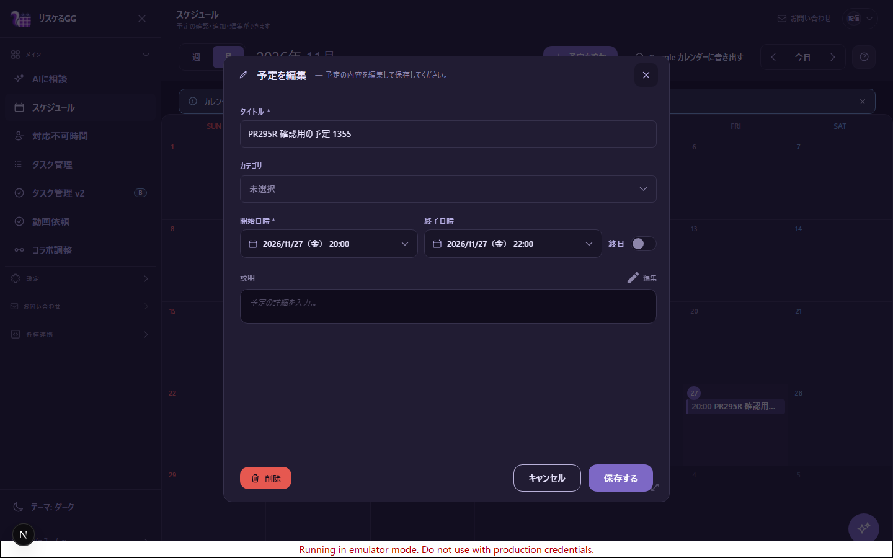
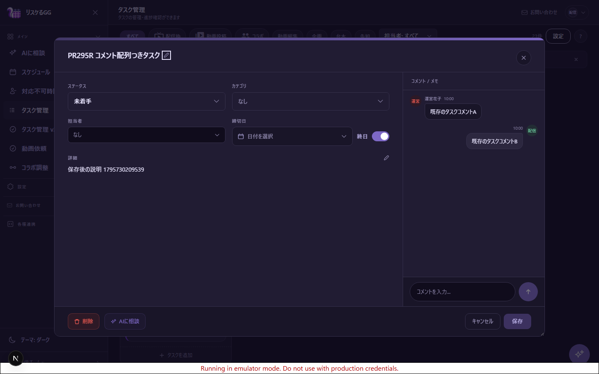
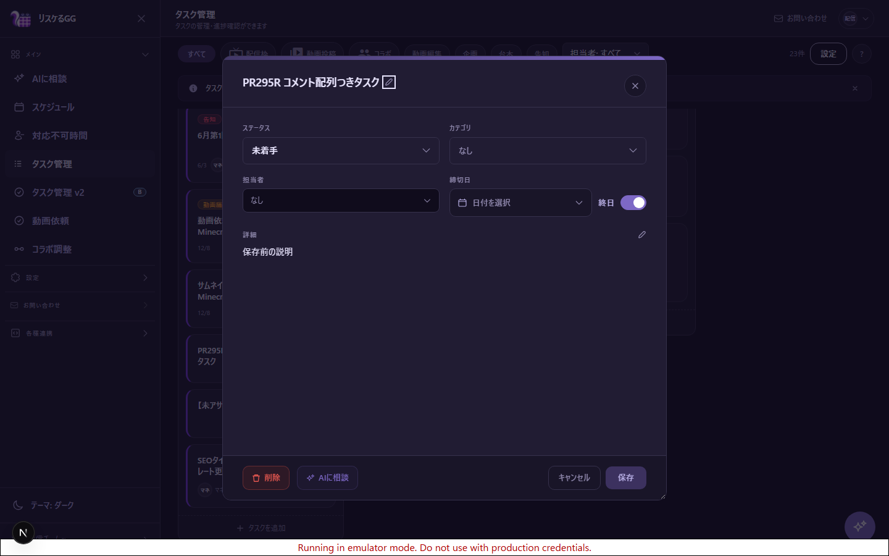
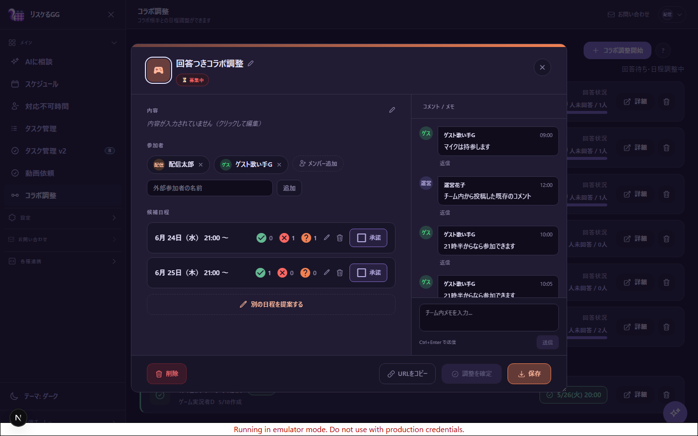
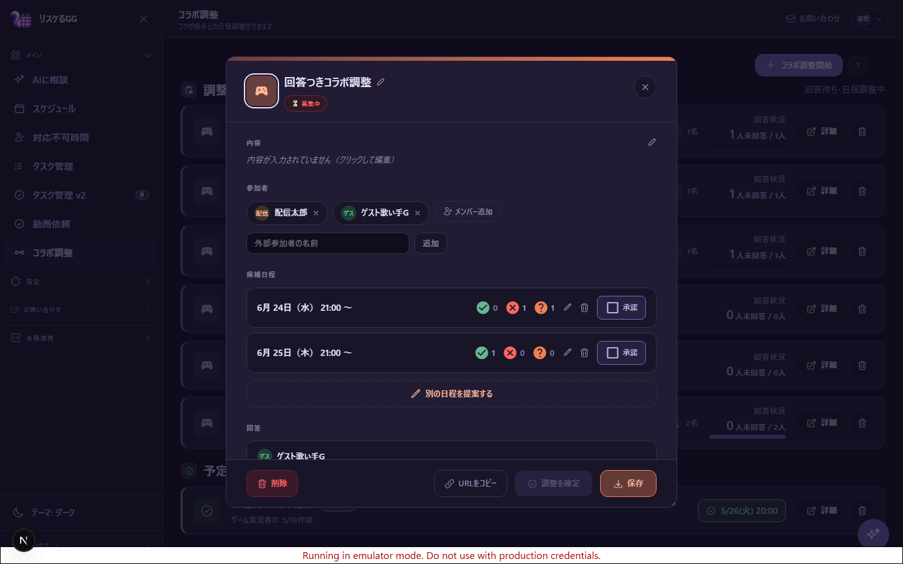
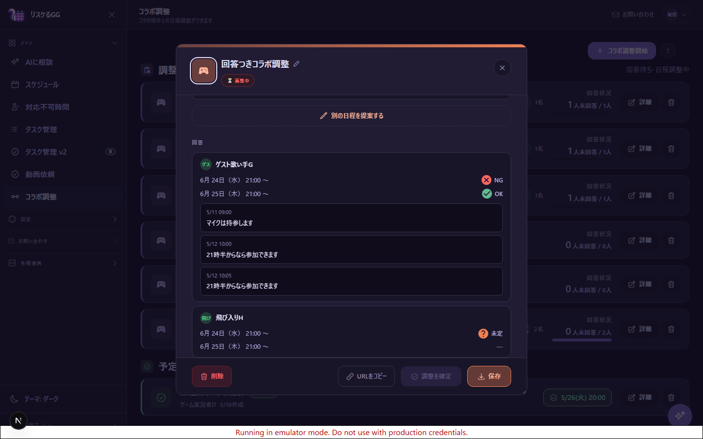
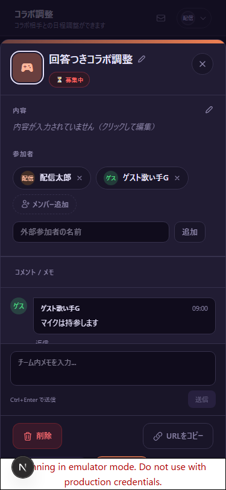
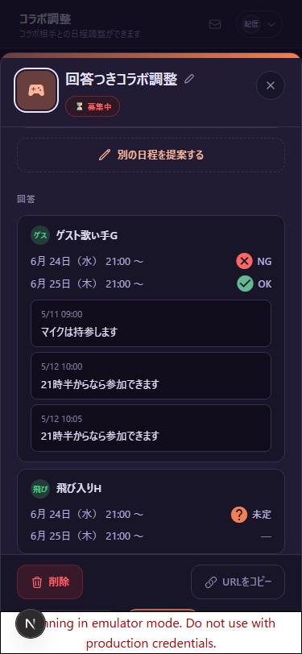

# 最終レポート

PR #295「コメント機能の整理」（対象のコミット: 8981f3d）

## 二次レビュー結果まとめ

- **最終セットの結論: 合格。** 一次レビューは 2 本（仕様・正本を見る仕様レビューと、コード・テスト・シードを見るコードレビュー）で、どちらも要修正 0 件。二次レビューは両方を妥当と判定した。
- **この PR の内容**
  - スケジュール・タスク・コラボ調整のコメント欄を廃止した。
  - コラボ詳細に、回答者ごとの「回答」の欄（候補日程ごとの可否と、回答者が書いたコメント）を足した。
  - AI に渡す情報と案内文から、タスクのコメントを外した。
  - 上記と、未実装の「対応不可コメント」について、変更仕様と正本・共通用語を更新した。
- **一次の確認範囲**
  - 仕様: 観点 21 項目（市場・アプリ制約・設計・実装性）のすべてに結果と根拠がある。本番反映の手順は、正本のリリースフローと突き合わせた。
  - コード: この PR で実装した受入条件 16 件（AC-1〜11、33、34・35、37・38）を、メンバー・スタッフ・未ログインの 3 つの立場で操作し、Firestore の文書の前後も比べた。
  - 自動の検査: CI は 3 件とも成功。ローカルの一括検証（lint・型・ユニットテスト 453 件）は成功。未ログインで動く E2E は 18 件成功。コラボの E2E は 2 件成功・7 件スキップ（スキップは既存の問題で #302）。
- **二次が妥当とした根拠**（コードを読んで裏取りした）
  - コメントを持つ既存のタスク文書は、読み込みでも保存でもコメントの配列に触れない。データは消えない。
  - コラボの「回答者が書いたコメント」と「チーム内から書かれた既存のコメント」の区別は、回答を保存するサーバー側の処理が書く値と一致する。
  - 詳細を開いている間に届いた回答は、タイトルだけを変える保存では上書きされない。
- **二次が不適切と判定した一次の指摘**: 最終セットには無い。2 セット目では、二次が一次の確認不足を 2 点（本番反映の順序が正本と逆、持ち越し事項の記録先が無い）指摘し、やり直しになった。3 セット目で解消を確認した。
- **別 Issue に切り出した指摘**
  - #302 コラボの E2E（SC-001〜SC-008）が未認証のため常にスキップされる
  - #303 ログイン後の画面の UI 変更を CI の E2E（smoke）で検証できない
  - #305 コラボ詳細を開いている間に届いた回答が、候補日程の削除・編集の保存で上書きされる（この PR より前からある挙動。二次が起票）
  - #246 へのコメント: 対応不可コメントの実装で先に決める 2 点（下の「人が確認すべき点」の 6）

| セット | 範囲 | 一次判定 | 二次判定 | 主な指摘・判断 |
| ------ | ---- | -------- | -------- | -------------- |
| 1（149362d） | 仕様の全体 | 要修正 | 妥当 | AI のプロンプトの版上げの欠落、所有者の決定に無い判断の未分類、コラボ「回答」欄で実装者に残る設計判断の 3 点 |
| 2（a4e82b3） | 仕様の全体 | 合格 | やり直し | 本番反映の順序が正本のリリースフローと逆だった。書き込みが完了しない間の挙動の持ち越し先が無かった |
| 3（8981f3d、最終） | 仕様とコードの全体 | 合格（仕様）・合格（コード） | 妥当 | 前回の 2 点は解消。仕様の推奨 2 件は #246 に記録。コードの推奨 4 件は細部（実行されないテストの古い記述、空行、自動テストの追加、コード内コメントの文言）で、要修正にしない判断を妥当とした |

## 画面の変更

3 つの詳細モーダルからコメント欄（右カラム）が無くなり、1 カラムになった。PC の既定の幅は 720px（変更前はスケジュール・タスクが 1180px、コラボが 900px）。スマホ幅（375px）は全幅のまま。

画像の下端の赤い文字の帯は開発環境だけに出る表示で、この PR とは関係ない。

| 画面・操作 | 変更前 | 変更後 |
| ---------- | ------ | ------ |
| スケジュールで「予定を追加」を開く（PC） |  |  |
| スケジュールで既存の予定を開く（PC）。変更前の画像は無い（右カラムにコメントの一覧と入力欄があった） | — |  |
| タスク管理で、コメントを持つ既存のタスクを開く（PC）。既存のコメントは表示されなくなる（データは残る）。2 枚は撮った時点が違い、説明欄の文言は変更前の画像のほうが新しい |  |  |
| コラボ調整で、回答のあるコラボの詳細を開く（PC） |  |  |
| 同じ詳細を下へスクロールする（PC）。「回答」の欄に、回答者ごとの可否と回答者のコメントが出る。チーム内から書かれた既存のコメントは出ない | — |  |
| 同じ詳細をスマホ幅（375px）で開き、「回答」の欄まで下へスクロールする |  |  |

## lint / E2E 定義の変更

| 変更 | 内容 | 理由（finding Issue など） |
| ---- | ---- | -------------------------- |
| `tests/e2e/collabs/collab-ui-redesign.spec.ts` | SC-012（コメント入力欄が見える）と旧 SC-013（コメントを送信できる）を削除。新 SC-013 を追加: メンバーとスタッフでサインインし、コメント欄が無いこと、「回答」の欄に回答者 2 人の行・日時の昇順の可否・回答者のコメント 3 件が出ること、チーム内から書かれた既存のコメントが出ないことを確かめる | 受入条件 AC-11。コメント欄の廃止（#260） |
| `tests/e2e/tasks.spec.ts` | コメントアウトされていた「コメント入力欄が丸型フィールドである」のテストを削除（もともと実行されていない） | コメント欄の廃止 |

- 違反したときのエラーメッセージ例: 該当なし（lint のルールは変えていない）。
- 既存コードの違反件数と、この PR での修正件数: 該当なし。
- CI の実行時間・必須チェックへの影響: なし。コラボの spec は Emulator が要る組に入っており、CI では実行されない。CI の E2E は 1 分 16 秒で成功している。
- ローカルでの実行結果（一次レビュー）: 新 SC-013 は 2 件とも成功。同じファイルの SC-001〜SC-008 の 7 件はサインインしない作りのためスキップ（#302）。
- 新 SC-013 は、シードに足したコラボ 1 件（「回答つきコラボ調整」）を使う。条件つきのスキップは入れていない。
- 補足: `tests/e2e/tasks.spec.ts` のコメントアウトの中に、変更前の幅（1180px）を前提にした記述が残っている。実行されないので動作に影響は無い（#302 で扱う）。

## 人が確認すべき点

1. **所有者の確認なしで置いた仮定**（変更仕様 `docs/変更仕様/comment-policy.md` の「置いた仮定」に一覧がある）。特に次の 4 点。
   - コラボ「回答」の欄の細部: 回答者ごとに 1 行、回答者名の昇順、同じ回答者のコメントは古い順にすべて表示、OK / NG / 未定以外の値は「—」。詳細を開いた時点の値を表示し、開いている間に届いた回答は開き直すと出る。
   - モーダルの既定の幅を 720px にしたこと。実装者の判断で、変更仕様の設計には追記したが「置いた仮定」の一覧には載っていない。あわせて、PC の既定の高さではコラボ詳細の「回答」の欄が下へスクロールしないと見えない（上の画像）。見た目として問題ないかを見てほしい。
   - 対応不可コメントは、フォームの確定で 1 件ずつすぐに書き込む。既存の変更仕様 `unavailability.md` の決定 15（メモは「保存」でまとめて書く）は引き継がない。
   - 対応不可コメントの書き込みが完了しない間は確定・削除を押せず、フォームを閉じない。対応不可の「保存」にある「10 秒後の案内」に当たるものは設けない。
2. **閉じる Issue**: この PR が閉じるのは #260 だけ。#246 は、対応不可コメントの実装 PR で閉じる。
3. **正本と実装の食い違い**: 正本を先に更新したため、対応不可コメントの実装がマージされるまで、正本（対応不可コメント）と実装（対応不可メモ）が食い違う。`docs/仕様・計画/unavailability/README.md` の「実装状況」に書いてある。
4. **この PR に本番作業は無い**（アプリのデプロイだけ）。既存のデータ（タスクのコメント、コラボのチーム内コメント）は消さず、表示しないだけ。
5. **対応不可コメントの実装 PR には本番作業がある**: リリースフローの順（アプリ → Firebase へのデプロイ → 移行スクリプト）のまま、Firebase へのデプロイの直後に、既存メモの移行スクリプトを実行する。この間はコメントが使えない、または既存のメモが見えないので、間を空けずに続けて行う。
6. **#246 に記録した持ち越し 2 点**（対応不可コメントの実装の着手前に、正本に 1 文ずつ決める）
   - 書き込みが完了しない間に、フォームのキャンセル（× と Esc を含む）を押せるか。
   - コメントの購読が失敗した場合の表示（対応不可の表示・入力を止めるかどうか）。
7. **起票した Issue**: #302・#303 はテストの仕組みの課題で、ログイン後の画面の回帰は今のところ CI で検出できない。この PR のスケジュール・タスクのモーダルは、手動の確認だけになっている。#305 は既存の不具合で、コラボ詳細を開いたまま候補日程を削除して保存すると、その間に届いた回答が消える。コードを読んで見つけたもので、実行での再現はしていない。
8. **ブランチの状態**: develop より 1 コミット遅れている（Emulator 接続時の警告表示をやめる変更。`src/lib/firebase/client.ts` だけで、この PR の変更ファイルとは重ならない）。規約ではマージ前に develop へ追従する。追従するとコミットが変わるが、変更内容が同じなら再レビューは不要な仕組みになっている。
9. **PR のタイトル**: レビュー時点では `docs(spec):` のままだったため、実装を含むことが分かる題名に直した。
10. **リリースノート**: 利用者に見える変更（コメント欄の廃止、コラボ詳細の「回答」の欄）なので、マージ後にリリースノートの下書きへ 1 行足す。
11. **Functions のコード内コメント**: `functions/src/notifications/taskDiscordNotifications.ts` に、通知しない変更の例として「コメント」の語が残っている。説明として誤りではなく、この PR は Functions を変更しない方針のため直していない。Issue にもしていない。気になる場合は旧画面の削除（#267）で一緒に直せる。
