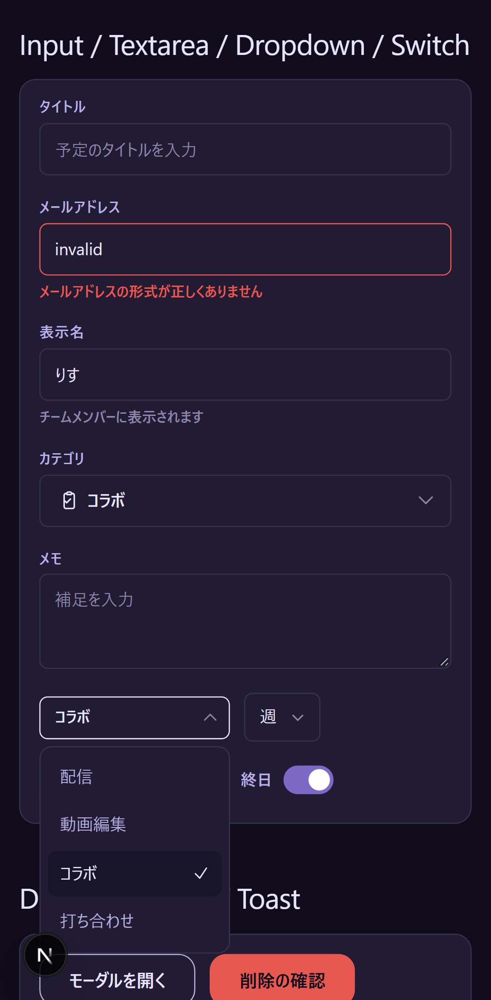
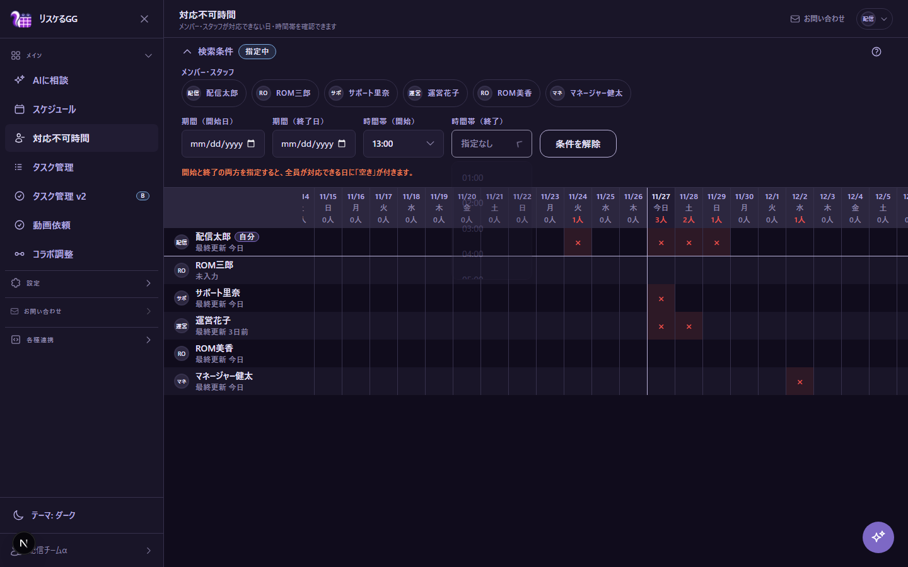
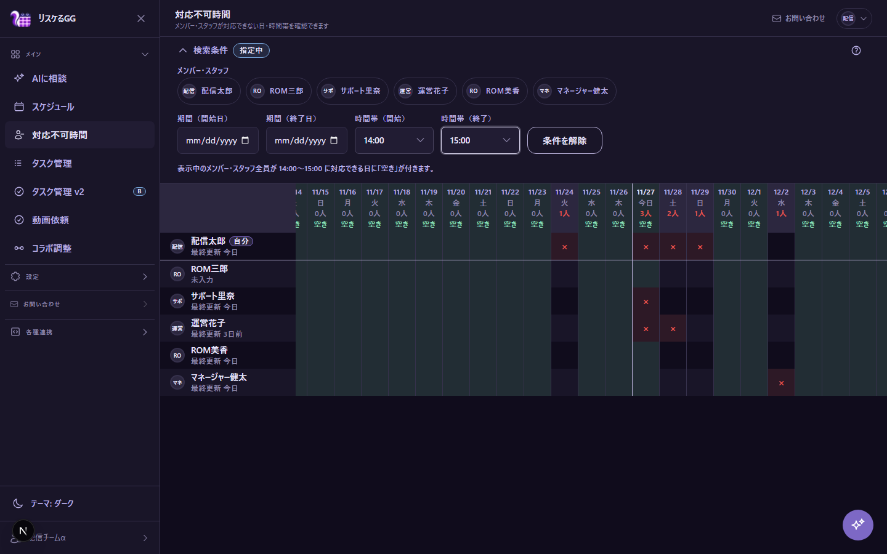

# 最終レポート

## 二次レビュー結果まとめ

- 最終セットの結論: 合格。一次は、待ち行を外した E2E ⑤ の繰り返し実行、アクセシビリティツリーを有効にした Chrome での確認（警告 0、同名の選択肢が 2 つ見えた回 0/60）、マウス・タッチ・キーボードでの操作、フォーカスの戻り、部品側の修正を消すとテストが落ちることを確かめた。二次は、原因の説明を Base UI 1.9.0 のソースで、テストの書き方を変えた理由を Playwright 1.65.0 のソースで裏取りし、一次の判定を妥当とした。二次ではアプリと E2E を動かしておらず、動作の数値は一次の実行記録による
- 二次が不適切と判定した一次の指摘: なし
- 別 Issue に切り出した指摘: #304 E2E ⑤（対応不可の定期入力）が、保存後の待ちでまれに 30 秒タイムアウトする

| セット | 範囲 | 一次判定 | 二次判定 | 主な指摘・判断 |
| ------ | ---- | -------- | -------- | -------------- |
| 1（fdae4b1） | 全体 | 要修正 | 行っていない | 閉じた側に `aria-hidden` を付ける瞬間、フォーカスがまだ選択肢に残っており、アクセシビリティツリーが有効な Chrome で警告が出る。再現手順つきの回帰だったので、二次を挟まず修正を優先した |
| 2（c6007ad） | 全体 | 合格 | 行っていない | `inert` に変更して解消。推奨として「部品側の修正を検出するテストが無い」が出た。この推奨への対応で HEAD が進んだため、二次は行っていない |
| 3（06102d4） | 全体 | 合格 | 合格 | E2E ⑤ に、閉じた Dropdown が `inert` であることの確認を追加。指摘なし。二次は 1・2 回目の指摘もあわせて妥当と判定した |

## 画面の変更

見た目は変わらない。共通部品 `Dropdown` の、閉じている間のポップアップに属性を 1 つ足しただけで、フェードアウトの動きも同じ。このため変更前の画像は撮っていない。下は変更後の動作確認の画像。

| 画面・操作 | 変更前 | 変更後 |
| ---------- | ------ | ------ |
| デザイン確認ページ（モバイル幅・タッチ）。1 つ選んだ直後に隣の Dropdown を開く | 撮っていない（見た目は変わらない） |  |
| 対応不可時間の検索条件。「時間帯（開始）」を選んだ直後に「時間帯（終了）」を開く（開いた直後で、フェードインの途中） | 撮っていない（見た目は変わらない） |  |
| 同じ画面。キーボードだけで開始・終了を選んだ後 | 撮っていない（見た目は変わらない） |  |

## lint / E2E 定義の変更

| 変更 | 内容 | 理由（finding Issue など） |
| ---- | ---- | -------------------------- |
| `tests/helpers/dropdown.ts`（新規） | Dropdown を開き、開いたトリガーが指す選択肢の一覧の中から選ぶヘルパー | 閉じた Dropdown の選択肢はフェードアウトが終わるまで DOM に残る。Playwright はロールで探すとき `inert` の要素を除外しないので、ページ全体から名前で探すと、閉じた側の同名の選択肢にも当たる |
| `tests/e2e/unavailability/unavailability-edit.spec.ts` | 選択肢を選ぶ 2 か所をヘルパーに置き換え。#241 の回避として入れていた待ちの行を削除。閉じた「終了」のポップアップが `inert` であることの確認を追加 | #241 の対応の目安（待ちの行を外す）。追加した確認は、部品側の修正が外れたことを検出するため |
| `tests/e2e/unavailability/unavailability-view.spec.ts` | 選択肢を選ぶ 2 か所をヘルパーに置き換え | 同上 |

- 違反したときのエラーメッセージ例: 部品側の修正を一時的に消して E2E ⑤ を流すと、追加した確認（205 行、`inert` が true であること）で 3 回中 3 回失敗し、受け取った値は false だった（一次レビューの記録。二次では出力させていない）
- 既存コードの違反件数と、この PR での修正件数: ページ全体から選択肢を探していた箇所は 4 か所で、4 か所とも置き換えた。残りは 0
- CI の実行時間・必須チェックへの影響: なし。変更した 2 つの spec は emulator プロジェクトで、CI は smoke プロジェクトだけを実行する

## 人が確認すべき点

- **Issue の理解と実際の原因が違った。** Issue #241 は「開いた側の選択肢が見えない」としていたが、開いた側は正常だった。実際は、閉じた側の選択肢がフェードアウトの間（約 250ms）も支援技術と自動テストから見えており、自動テストがそちらを掴んで失敗していた。この PR は閉じた側を `inert` にした
- **人の操作での実害は確認できていない。** マウス 60 回、タッチ 60 回（`inert` 版でさらに 20 回）で、開いた側は常に表示され押せた。Issue にある「モバイル幅のタッチ操作で 1 度観察」は再現しておらず、原因も分かっていない。この PR で Issue #241 は閉じる。実機のタッチで同じ現象を見たら、手順を添えて新しい Issue にしてほしい
- **実際のスクリーンリーダーでは未確認。** 確認は Chrome のアクセシビリティツリーまで
- **今後 Dropdown を操作する E2E は、新しいヘルパーを使う必要がある。** ページ全体から選択肢を名前で探す書き方は、同じ名前の選択肢を持つ Dropdown が並ぶ画面で失敗する。この決まりを機械的に検査する仕組みは無い
- **回帰の確認は CI で動かない。** 追加した確認は emulator プロジェクトの spec にあり、部品側の修正が外れても CI は通る。手元で emulator の E2E を流したときだけ検出できる（#303 が扱っている課題）
- **#304**: E2E ⑤ が、Dropdown の操作を通過した後の保存まわりで、まれに 30 秒でタイムアウトする（合計 300 回で 2 回）。Dropdown とは無関係だが、1 件は「閉じる」が押せないままになっており、画面側の問題かどうかは未確認
- 確認した範囲: 動作を見たのはデザイン確認ページと対応不可時間の画面。Dropdown を使う他の 12 ファイルは同じ部品をそのまま使っているが、個別には開いていない。unavailability 以外の emulator の E2E は流していない
- ブランチは develop に対して遅れていない（二次レビュー時点）
