# 最終レポート

PR #307「他にメンバーがいれば退出・アカウント削除の前の指名を求めない」（対象コミット 59e0d00、4 ファイル、+38 / -4）

## 何が変わるか

メンバー（全権限のロール）がチームを退出する、またはアカウントを削除するとき、これまでは「メンバーで、チームに 2 人以上いる」だけで新しいメンバーの指名を求めていました。正本 TE-010-2 のとおり、「自分が最後のメンバーで、ほかに所属者がいる」ときだけ求めるように直しています。

- 変わるのは画面の判定だけです。サーバー側（アカウント削除・退出の Functions）は以前から正しい条件で判定しており、本 PR では変更していません
- 判定は新しい関数 isLastMember にまとめ、チーム画面の退出ダイアログと、個人設定のアカウント削除の 2 か所で使っています。ユニットテストを 3 件追加しています

## 二次レビュー結果まとめ

- 最終セットの結論: 一次・二次ともに合格（要修正 0 件）。修正は 1 回も入っておらず、最初のセットが PR 全体を対象にしていたため、これを最終セットとしています
- 一次が確認したこと
  - 受入条件 TE-010-2 の 4 分岐（他にメンバーあり / 唯一のメンバーでスタッフあり / ソロチーム / スタッフ）と境界値を、ユニットテストと画面操作で確認
  - Emulator と開発サーバーで、変更前（develop）と本 PR を同じ操作で比較。他にメンバーがいる状態での退出は実行まで行い、所属が消えることを確認。コンソールのエラーと失敗リクエストは無し
  - 同じ旧条件がほかの画面に残っていないこと、CI（Lint と型チェック / ユニットテスト / E2E smoke）が通っていること
- 二次が妥当とした根拠: 一次の指摘 2 件と起票 2 件を、コードと正本に突き合わせて事実と一致することを確認。受入条件ごとのテストケース、アプリを動かした確認、呼び出し元の確認、範囲外の起票がそろっていると判定。二次はアプリを動かしていません
- 二次が不適切と判定した一次の指摘: なし。ただし一次の記述に不正確な点が 1 つあります。「正本の退出フローと実装は一致」とありますが、フロー 5 の「残りのメンバー全員に脱退の通知を送る」は実装にありません。これは #277 で起票済みです（本 PR より前からの状態）
- 別 Issue に切り出した指摘
  - #309 他にメンバーがいるチームからメンバーが退出すると所属なしになり、ダイアログの案内（ソロチームに自動移行）と食い違う
  - #310 アカウント削除の新メンバー指名がアクティブチームの分しか出ず、他チームで最後のメンバーだと削除できない

| セット | 範囲 | 一次判定 | 二次判定 | 主な指摘・判断 |
| ------ | ---- | -------- | -------- | -------------- |
| 1（最終） | PR 全体 | 合格 | pass | 要修正なし。退出後の状態と案内の食い違いは、正本が未決定のため #309 へ切り出し。名前とコメントの古さ（推奨）は本 PR では直さず #309 に追記。#310 は変更前からの不具合として起票のみ |

## 画面の変更

確認に使ったのは手元の Emulator のデータで、6 人のチーム（自分のほかにメンバーがいる）です。ダイアログの画像は、開くアニメーションの途中で撮られたため薄く写っています。文言とボタンは読み取れますが、見た目の確認には使えません。

| 画面・操作 | 変更前 | 変更後 |
| ---------- | ------ | ------ |
| チーム画面のチームタブで「現在のチームから退出する」を押す。変更前は「先に別の所属者をメンバーに変更してください」と出て退出できない。変更後は「退出する」ボタンが出る | 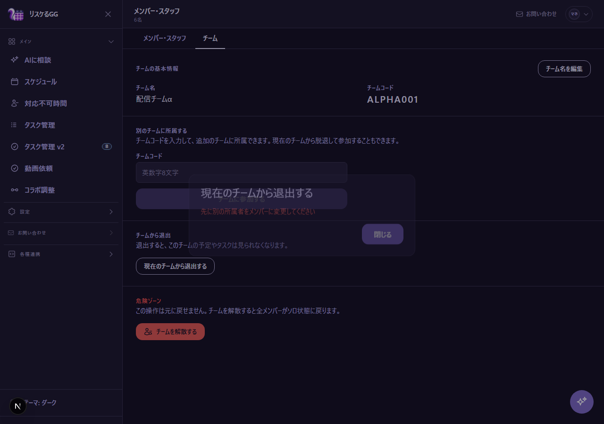 | 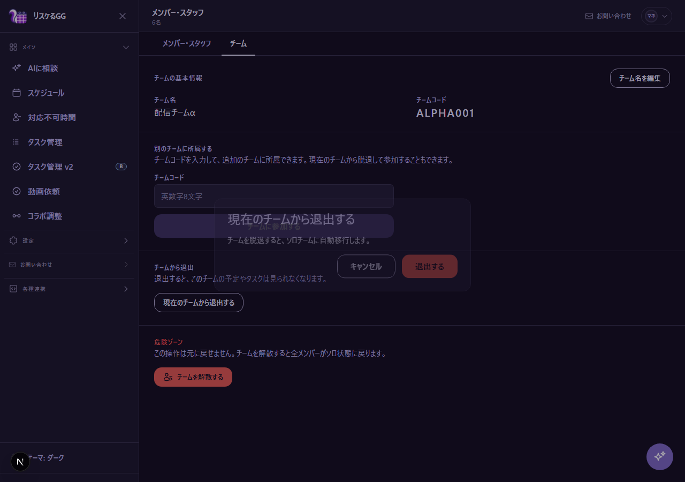 |
| 個人設定のアカウントタブを開く。変更前は「削除前に新しいメンバーを選択してください。」、変更後は通常の説明文になる | 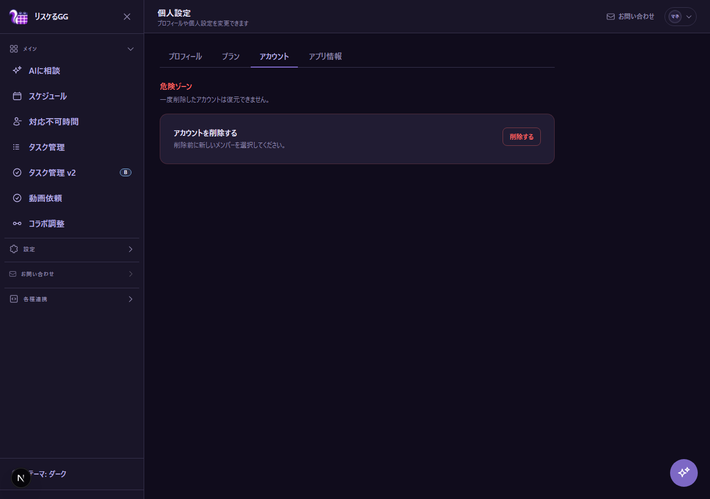 |  |
| 同じタブで「削除する」を押す。変更前は新しいメンバーを選ぶ欄が出る。変更後は欄が出ない | 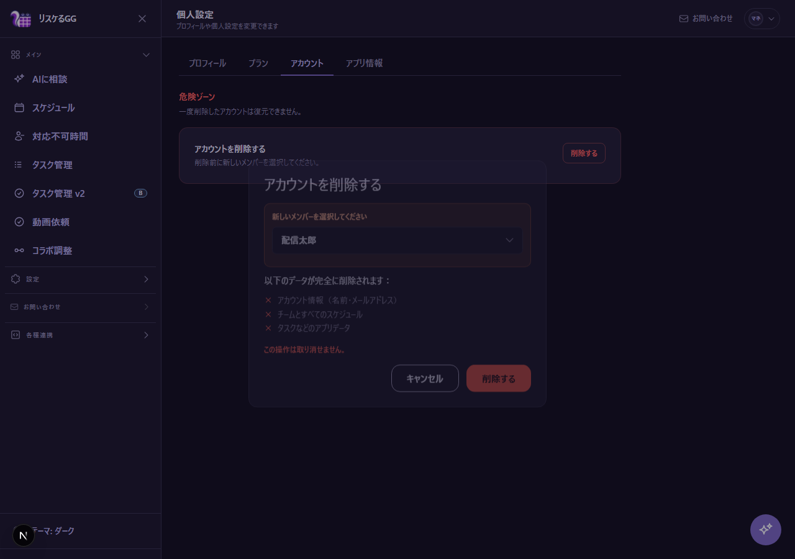 | 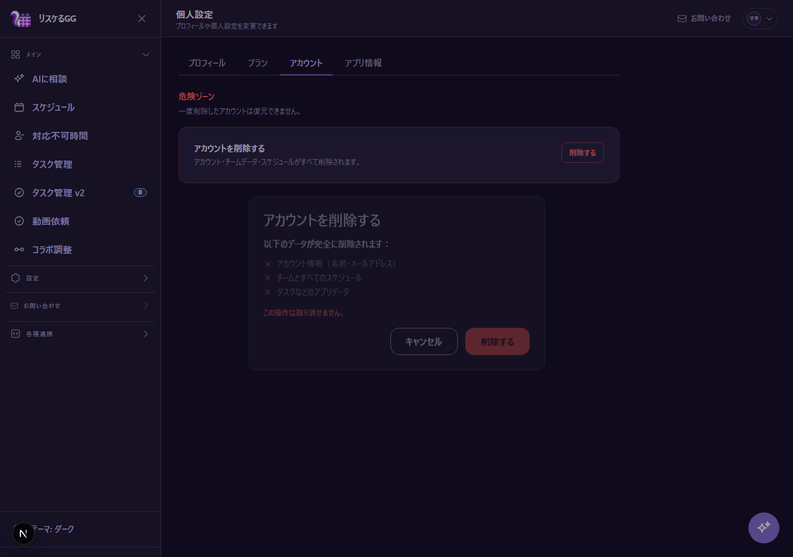 |

変更後に「退出する」を実行した結果です。退出は成功しますが、所属がこのチームだけだった場合は、案内の「ソロチームに自動移行します」と違って所属なしになります（#309。下の「人が確認すべき点」の 1）。

| 退出を実行する直前 | 退出後のチーム画面 | 退出後のダッシュボード |
| ------------------ | ------------------ | ---------------------- |
| 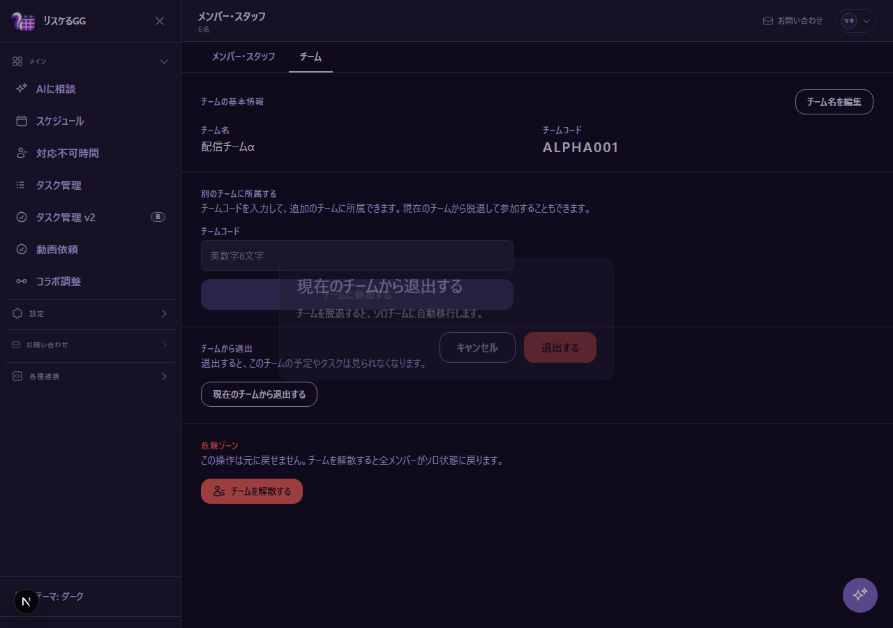 |  | 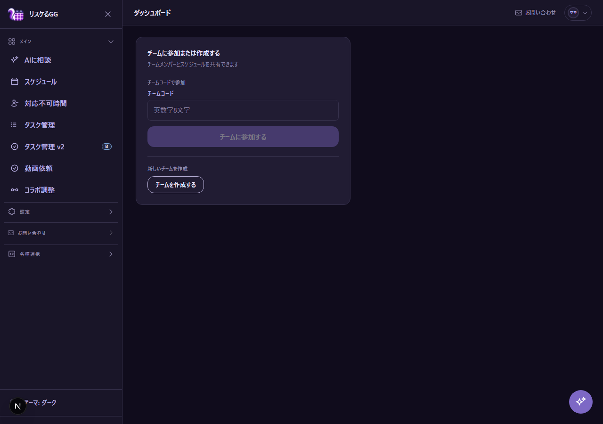 |

変わらないことを確認した画面（変更後のみ）

| 状態 | 退出ダイアログ | アカウントタブ | 削除ダイアログ |
| ---- | -------------- | -------------- | -------------- |
| 唯一のメンバーで、スタッフがいる（指名が必要なまま） | 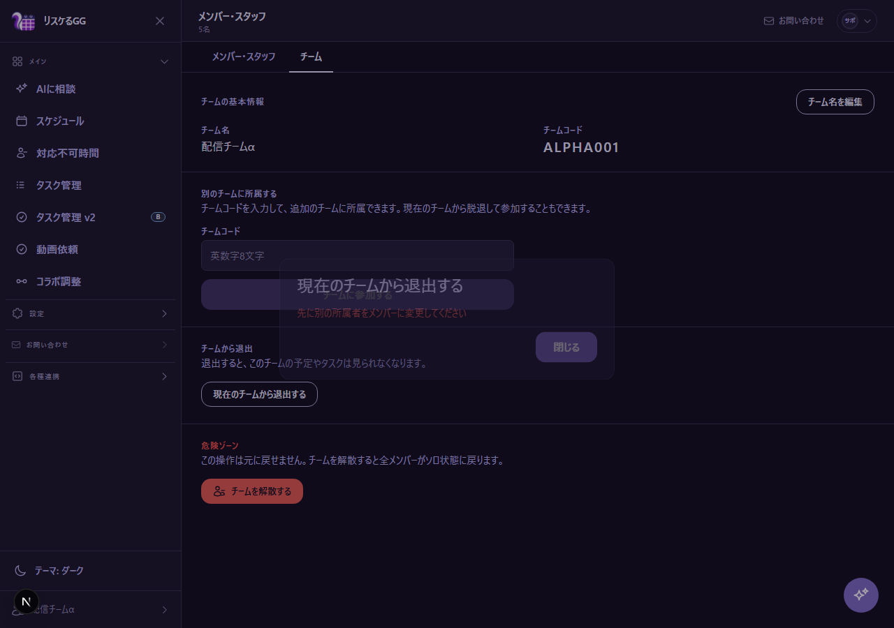 |  | 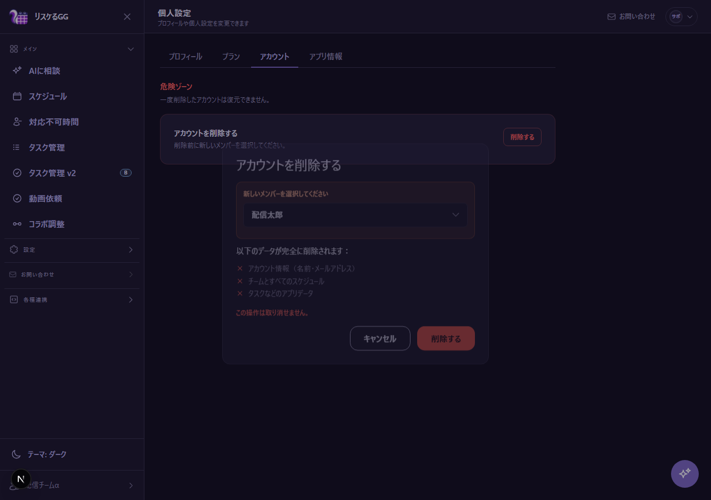 |
| スタッフ（指名は不要なまま） | 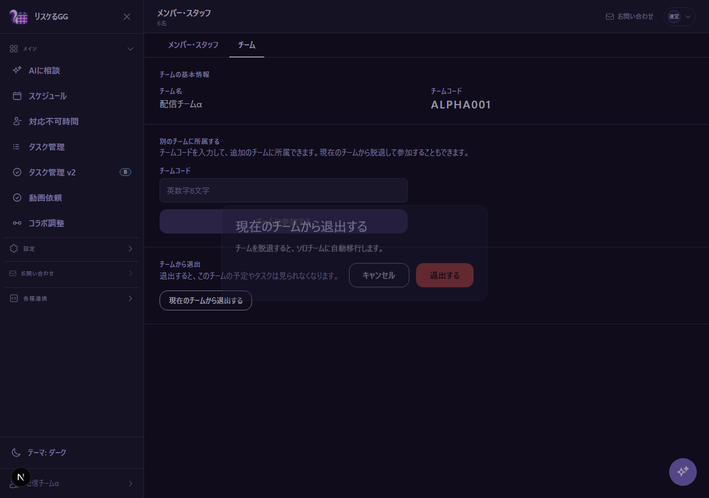 | 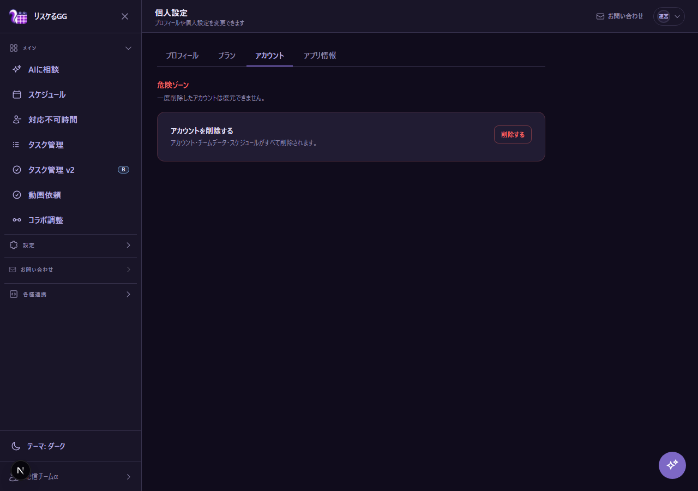 | 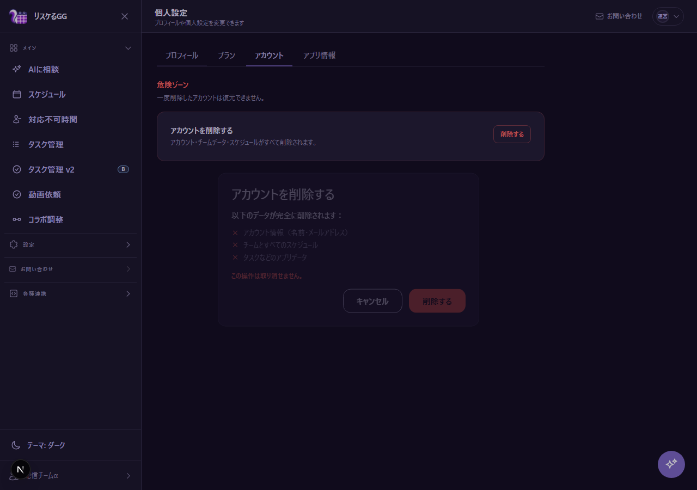 |

## 人が確認すべき点

1. **#309 の仕様判断をリリース前に済ませるか（判断が必要）**
   本 PR をマージすると、所属が 1 チームだけのメンバーが、他にメンバーのいるチームから退出できるようになります。そのとき画面は「ソロチームに自動移行します」と案内しますが、実際には所属なしになり、チームへの参加か作成を求める画面になります。データは失われず、操作は続けられます。
   変更前はこの利用者は退出そのものができなかったため、この食い違いに画面から到達できませんでした。正本は、ほかに所属チームが無いときの退出後の状態を決めていません。そのため本 PR では直さず #309 に切り出しています。リリース前に #309 を決めるか、この食い違いを承知でリリースするかは、人が決める事項です。

2. **アカウント削除の実行（未確認）**
   一次の確認は削除ダイアログの表示までで、削除は実行していません。次の 2 つを確認してください。
   - メンバーで、他にメンバーがいる状態: 指名なしでアカウントを削除できる（本 PR で変わる側）
   - 唯一のメンバーで、スタッフがいる状態: 指名した所属者がメンバーになり、自分の所属とアカウントが消える
   二次はコードを読み、他にメンバーがいる場合は指名の有無にかかわらずサーバーが同じ処理を通ること、本 PR で新しく通るサーバーの経路が無いことを確認しています。画面からの実行での確認ではありません。

3. **ソロチームのメンバーの退出ダイアログ（未確認）**
   「ソロチームを退出します。…」と「退出する」ボタンが出ることを、画面では確認できていません。一次の確認中に退出を実行して所属なしになり、この画面を開けなかったためです。判定の関数はユニットテストで確認済みで、この表示を決める条件式は本 PR で変更していません。

4. **モバイル幅（未確認）**
   確認はデスクトップ幅だけです。本 PR はレイアウトを変えていませんが、変更後に出るボタンや、消える指名欄のモバイルでの見え方は見ていません。

5. **#310 は画面で再現していない**
   コードの読み取りで見つけたもので、変更前から同じ状態です。内容は「複数チームに所属し、アクティブでないチームで最後のメンバーになっていると、指名の欄が出ないままアカウント削除が失敗する」です。

6. **確認に使ったデータ**
   手元の Emulator のデータには、ロール移行前の値（operator / rom）が残っています。メンバー以外はスタッフとして読まれるため、判定の確認には使えましたが、移行後のデータだけでの確認ではありません。

7. **名前とコメントが変更前の意味のまま（動作への影響なし）**
   条件を受け取る変数とプロパティの名前（isMemberWithOthers、isMultiMember）と、コメント 2 か所が、変更前の条件を表したままです。本 PR では直さず、同じファイルを触る #309 に追記しました。
