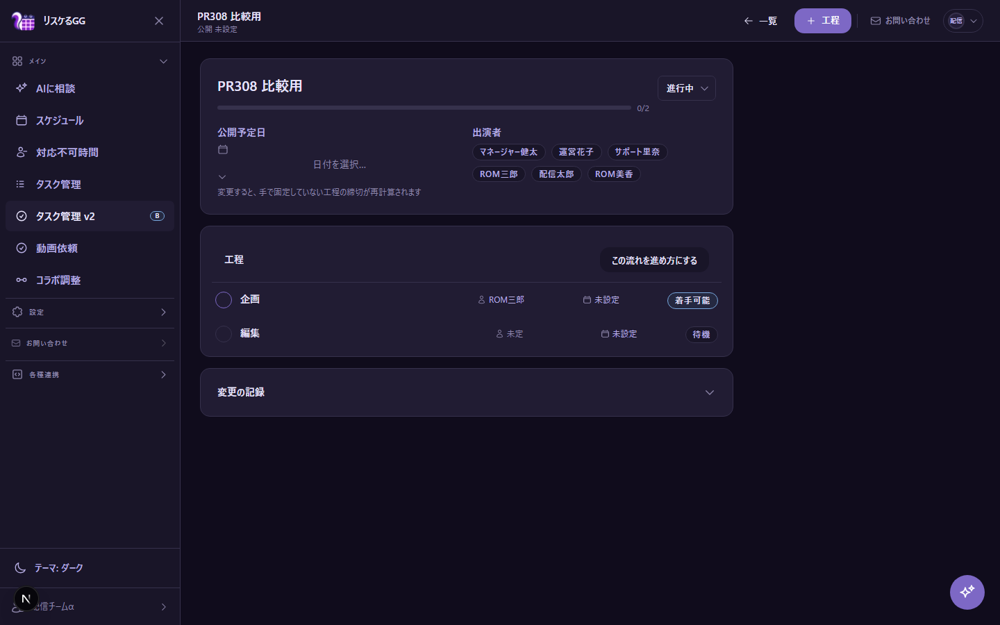
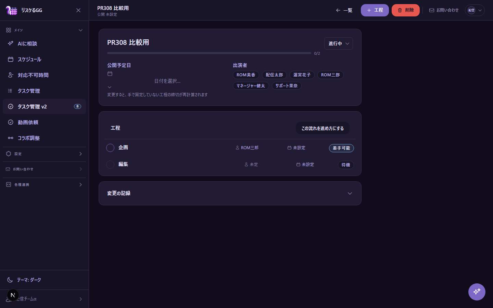
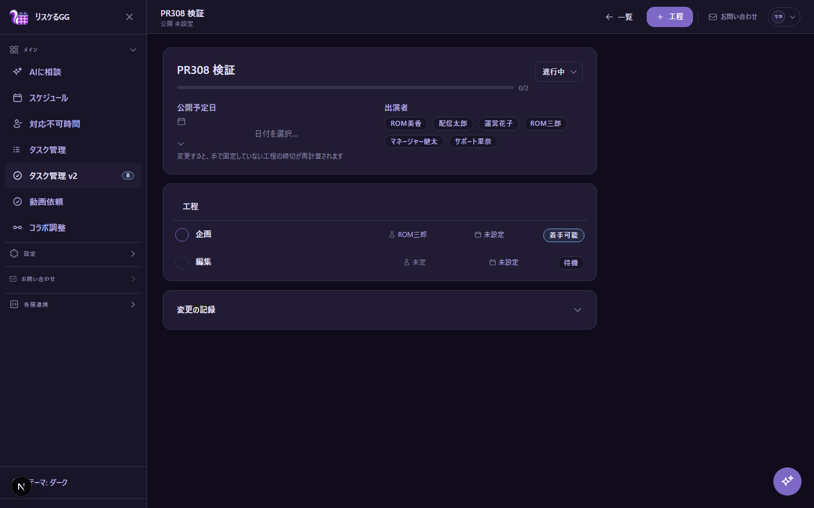
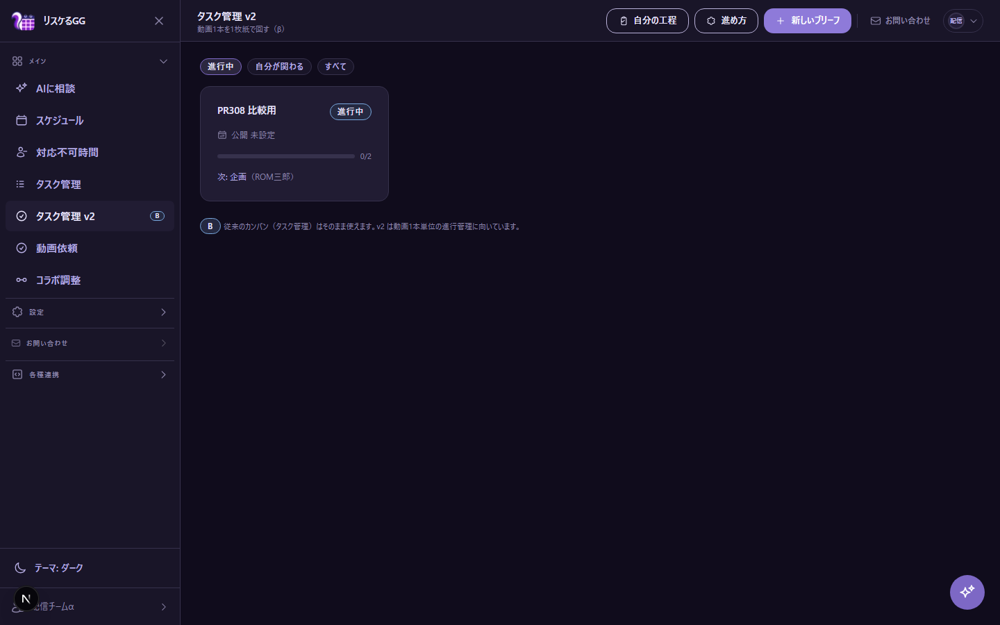
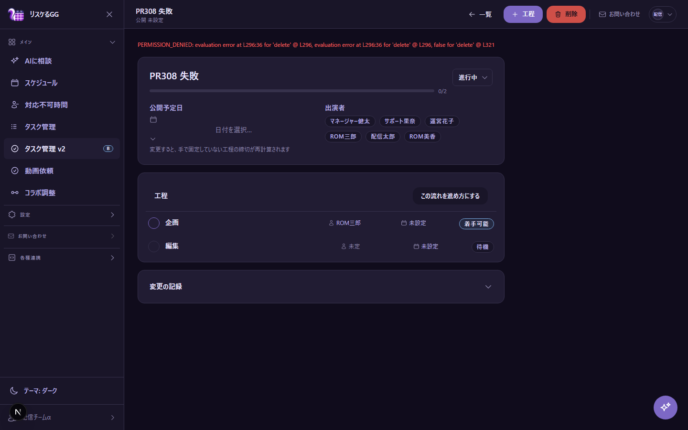

# 最終レポート

PR #308「ブリーフ削除と作成者・最終更新者の共通フィールドを追加する」/ 対象コミット 10acb40

## この PR で変わること

- **ブリーフの削除**: メンバーが 1枚紙の画面からブリーフを削除できる。配下の工程・工程コメント・差分も一緒に、1 回の書き込みで消える。失敗したときは何も消えず、エラーが表示される。スタッフには削除ボタンが出ない
- **作成者・最終更新者の記録**: スケジュール・タスク・コラボ・ブリーフ・工程・進め方・カテゴリ・カンバン列の 8 種類で、更新のたびに最終更新者と最終更新日時を記録する。工程・進め方・カテゴリ・カンバン列には作成者も記録する
- **ルール**: 進め方・カテゴリ・カンバン列・工程の作成時に作成者を本人に固定し、後から書き換えられないようにする。ブリーフ削除のため、差分の削除をメンバーに許可する
- **正本**: `team/model.md`、`production/requirements.md`（PD-060 / PD-061 / PD-070）、`production/model.md`、`integration/requirements.md`（IN-024-1）を実装に合わせた

## 二次レビュー結果まとめ

### 最終セットの結論

一次・二次とも合格（要修正 0 件）。

- 一次が確認した範囲: 受入条件（TE-018、TE-022、TE-023、PD-061）ごとのテストケースを、Emulator 上の画面操作と Functions の呼び出しで実行し、保存内容を Firestore で直接読んだ。CI（Lint & TypeScript、Unit Tests、E2E smoke）は合格
- 二次が妥当とした根拠: 一次の指摘と合格判定を、コード・正本・ルールと照合して事実と一致することを確認した。ルールは最初のセット以降変わっておらず、当時の検証結果が有効であることも確認した
- 二次はコードと仕様の読み取りだけで確認しており、アプリは動かしていない

### 二次が不適切と判定した一次の指摘

セット 1 の最初の一次に対して、次の点でやり直しを求めた。やり直し後に解消している。

- 反映順について「クライアントを先に出す」と勧めていたが、どちらの順でも拒否される操作が出る（事実と違う）
- ブリーフ削除を分割するか 1 回にまとめるかを「実装側の判断でよい」としていたが、正本に無い新しい決定で、ユーザーの判断が要る
- 最終更新者の付与漏れの一覧に、期待する値が決まっていない行があった。変更仕様の「共通のヘルパーを使う」が判定されていなかった
- タスク・スケジュール・コラボの最終更新者の確認が、理由なく未実施だった

二次の側の誤りも 1 件ある。セット 2 の二次は「AI チャットからのタスク更新でも、変更前から同じ例外になる」と補足したが、誤りだった（タスクの購読は一部の画面を開いている間だけ動く）。最終セットで訂正した。修正の内容には影響していない。

### レビューの経過

| セット | 範囲 | 一次判定 | 二次判定 | 主な指摘・判断 |
| ------ | ---- | -------- | -------- | -------------- |
| 1（5dfc812） | 全体 | 要修正 2 件 | fail | 一次のやり直しを求めた（上記） |
| 1 やり直し（5dfc812） | 全体 | 要修正 2 件、判断事項 3 件 | pass | 正本の未同期、最終更新者の付与漏れと共通ヘルパーの不足。削除の原子性・自動処理の値・反映手順をユーザーの判断に回した |
| 修正 1（a20d0f6） | — | — | — | 正本の同期、共通ヘルパー、付与漏れの解消、1 回の書き込みでの削除、自動処理は system、担当外しの記録 |
| 2（a20d0f6） | 全体 | 要修正 2 件、判断事項 1 件 | pass | 列・カテゴリの削除でタスク一覧の購読が例外になる（修正 1 が持ち込んだ回帰）。Discord 連携 ID の記録が正本と食い違う |
| 修正 2（10acb40） | — | — | — | タスクの購読の読み方を変更、連携 ID の記録の例外を正本に記載 |
| 3・最終（10acb40） | 全体 | 合格 | pass | 要修正 0 件。推奨 4 件は残る（下記） |

### ユーザーが決めたこと

1. ブリーフの削除は 1 回の書き込みで行う。上限（リクエストサイズ 10 MiB）を超えたら何も消さず、エラーとして見せる
2. 操作者がいない更新（自動処理、未認証の外部参加者のコラボ回答）の最終更新者は `'system'`、Discord 上の操作は `'discord-bot'`
3. 退出・Kick・アカウント削除に伴う担当外しも、最終更新として記録する
4. 反映はルール・Functions・クライアントを同時に出し、短時間の拒否を許容する
5. 削除後に残る工程コメントは #313 で扱う
6. Discord 連携 ID の記録（ブリーフのスレッド ID、工程の通知 ID）は最終更新に数えない

### 別 Issue に切り出した指摘

- #311 check-role-rules.mjs がタスクの直接削除の検査で失敗し、以降のルール検査が走らない
- #312 カンバン列・カテゴリの追加直後に toColumn / toCategory で TypeError が出る
- #313 工程コメントが親の工程・ブリーフ無しで作成でき、工程の削除でも残る
- #314 task / schedule / collab の model.md が共通フィールドと実装のフィールドを反映していない

### 残っている推奨（この PR では直していない）

- 削除ボタンの E2E（smoke）の spec が無い。権限と連鎖削除は単体テストとルール検査で確認している
- 削除に失敗したとき、Firestore のエラー文がそのまま表示される（下の画像）。同じ画面の他の操作と同じ扱い

## 画面の変更

変わるのはブリーフの 1枚紙（`/briefs/[id]`）だけ。メンバーには右上に「削除」ボタンが出る。

| 画面・操作 | 変更前 | 変更後 |
| ---------- | ------ | ------ |
| メンバーが 1枚紙を開く |  |  |

| 画面・操作 | 変更後 |
| ---------- | ------ |
| スタッフ（ブリーフの作成者本人）が 1枚紙を開く。削除ボタンは出ない |  |
| メンバーが「削除」を押して確定した後、一覧へ戻る。一次の記録では、削除したブリーフは一覧に出ない（写っているのは別のブリーフ） |  |
| 削除の書き込みが拒否されたとき。何も消えず、上部にエラー文が出て、もう一度押せる（Emulator でルールを旧版にして再現。a20d0f6 で撮影、この画面のコードは以後変更なし） |  |

## 人が確認すべき点

どのエージェントも実行できていない確認と、反映時の作業。

### 反映時の作業

- `firestore.rules` のデプロイ、Functions の再デプロイ、クライアントの反映を、続けて同時に行う
- ずれた間は次の操作が拒否される（短時間の拒否は許容する決定）
  - ルールが先: 古いクライアントからのカンバン列・カテゴリ・進め方の作成、工程の追加
  - クライアントが先: 作成者でもメンバーでもないスタッフによる、担当工程の完了・状態変更
- 新ルールの反映後、再読み込みしていない古いタブからの作成は拒否される。再読み込みで解消する
- 既存データには作成者・最終更新者が入っていない。埋め直しはしない。作成者の無いものはメンバーだけが編集・削除できる

### 本番相当の環境でしか確認できないこと

- **件数の多いブリーフの削除**: Emulator では 553 件を 1 回で消せた。ルールの参照回数の制限（一括書き込みで 20 回）の数え方が本番でも同じかは確認できていない
- **Discord 連携のある環境でのブリーフ削除**: スレッドと要約メッセージが書き換わらずに残ること、削除後に通知のボタンを押すと「見つかりません」が返ること（IN-024-1）。コードの読みだけで、実行していない
- **Discord 経由の登録・タスク更新・納品**: 最終更新者が `'discord-bot'` になること。単体テストだけで、実行していない
- **自動処理**: コラボの期限切れ（定期実行）、動画依頼の作成トリガー、動画依頼の作成（Discord 連携の設定が要る）。最終更新者は単体テストと差分の読み取りだけで確認している

### 挙動として知っておくこと

- **保存が確定する前の短い間の楽観ロック**: 列・カテゴリを削除した直後、付け替わったタスクを、書き込みの確認が戻る前に保存すると「競合」になる。確認が戻れば解消する。この短い間そのものは再現できておらず、コードの読みだけ
- **付随する更新で最終更新日時が進む**: 列・カテゴリの削除、退出・Kick・アカウント削除に伴う担当外しで、対象のタスク・スケジュールの最終更新日時が進む。別の画面で同じタスクを編集中の人は、保存時に「競合」になる。完了タスクの自動削除の起算も延びる
- **削除後に残る工程コメント**: 削除の直前に追加されたコメントや、削除後に古いタブから送られたコメントは残る（#313）
